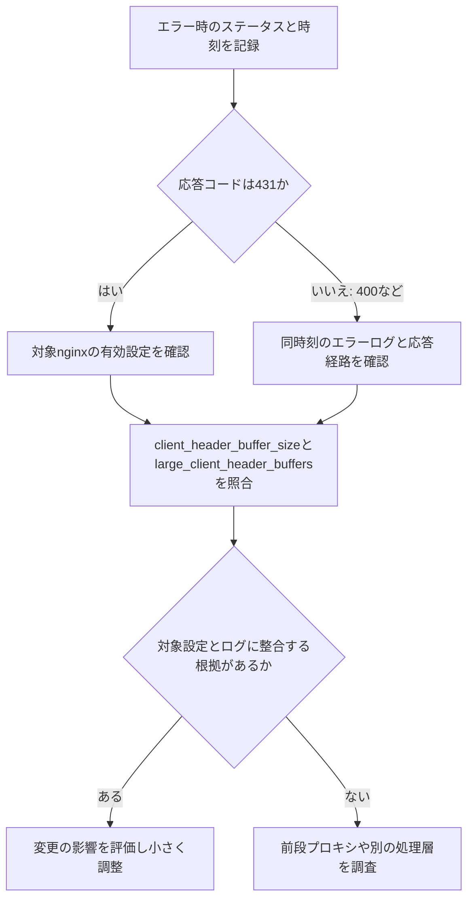

# HTTP 431とnginxの400を混同しない：Cookie・リクエストヘッダーが大きい場合の切り分け

検証水準: 未実行。独立した論理審査を別途実施する。

# HTTP 431とnginxの400を混同しない：Cookie・リクエストヘッダーが大きい場合の切り分け

**この記事について**  
この記事は、生成AIを活用した自動生成フローで作成しています。nginxのリクエストヘッダー用バッファ設定と、RFC 6585が定義するHTTP 431の意味を、確認済みの公式資料に基づいて整理します。個別環境のnginx設定、ログ、応答の発生箇所は確認していません。

**検証ステータス**：spec_checked（公式仕様を確認。個別環境での実機検証は未実施）

## まず確認すること

Cookieを含むリクエストヘッダーが大きくなってエラーが起きたときは、エラー画面の見た目だけで判断せず、まず次の2点を照合します。

1. クライアントが受け取ったHTTPステータスコード
2. リクエストを処理したnginxの有効設定と、その時刻のエラーログ

**431**は、ヘッダーフィールド全体または単一のフィールドが大きすぎるため、サーバーがリクエストを処理しない状態を示すステータスです。ただし、RFC 6585は431の使用を必須としていません。ヘッダーが大きい問題でも、必ず431が返るとは限りません。

一方、**400**はより広い意味を持つクライアントエラーです。400だけでは「Cookieが大きすぎる」とは断定できません。nginx自身、前段のプロキシ、別のWebサーバーやアプリケーションのどこが応答したかも、ステータスコードだけでは分からない場合があります。

## エラーが出たときの調査順序

次の図は、応答コードから設定とログを確認し、変更判断へ進む順序を示します。431ならヘッダーサイズ超過の可能性を調べ、400ならログや経路の情報で原因を絞ります。どちらの場合も、コードだけで発生箇所や原因が確定するわけではありません。



図の「根拠がある」は、単に設定値が小さそうだという印象ではありません。該当するnginxインスタンスの設定とエラーログが、対象リクエストの失敗と結び付いていることを指します。

## nginxの2つのバッファ設定

nginxの`ngx_http_core_module`には、リクエストヘッダーを読むための次の設定があります。

- `client_header_buffer_size`：リクエストヘッダーの読み取りに使うバッファサイズ。
- `large_client_header_buffers`：通常のバッファに収まらない長いリクエストヘッダーを読む場合に割り当てる、大きなバッファの数とサイズ。

nginxの公式資料によれば、長いCookieなどが通常のバッファに収まらない場合、大きなバッファが使われます。ただし、設定値だけを見てエラーの原因と決めつけることはできません。nginxは階層ごとの設定や仮想サーバーの選択を含む設定全体で動作するため、実際にリクエストを処理したインスタンスと有効な設定を確認する必要があります。

設定例を調べるときは、まず実際の値と適用範囲を読みます。以下は確認対象を示す断片であり、推奨値ではありません。

```nginx
http {
    client_header_buffer_size <環境に合わせた値>;
    large_client_header_buffers <個数> <サイズ>;

    server {
        # このserverに固有の設定があれば確認する
    }
}
```

山括弧の部分は説明用のプレースホルダーです。このままnginx設定へ貼り付けてはいけません。実環境の設定ファイルや、運用手順で許可された方法を使い、対象の`http`、`server`、`location`のどこに設定があるかを確認してください。設定変更の構文確認には、環境で定められた手順を使います。ここではnginxの稼働バージョンや起動方法が不明なため、確認コマンドや再読み込み手順を一律には指定できません。

## 431と400をどう読むか

RFC 6585の431は、サーバーがリクエストヘッダーのサイズを理由に処理を拒否するときに使える応答です。大きすぎる対象は、ヘッダー全体の場合も、Cookieなど単一のフィールドの場合もあります。クライアント側では、Cookieの削除・整理で改善することがありますが、業務アプリのセッションを失う可能性があるため、利用者に一律の削除を求める前に影響を確認してください。

400は「不正なリクエスト」を表す汎用的な応答です。RFC 9110のHTTP意味論は各HTTPバージョンに共通するため、400という数字だけからHTTP/1.1、HTTP/2、HTTP/3のどれで問題が起きたかを特定することもできません。nginxのエラーログにヘッダー読み取り失敗を示す記録があれば手掛かりになりますが、記録内容や出力先は設定とバージョンに依存します。対象時刻、接続先、仮想サーバー、前段の有無を合わせて確認してください。

| 観察したこと | そこから分かること | 次に見るもの |
|---|---|---|
| 431が返った | ヘッダーサイズ超過を理由に拒否した可能性が高い | 応答した層、対象nginxの有効設定、該当時刻のログ |
| 400が返った | リクエストが受理されなかったが、理由はコードだけでは不明 | nginxのエラーログ、前段プロキシ、実際の応答元 |
| 設定を広げても再発する | 設定対象や適用先が違う、または別の層で制限されている可能性がある | 仮想サーバー選択、ロードバランサーやCDNなどの経路 |
| 一部の利用者だけで発生する | Cookieなどリクエストごとの違いが関係する可能性がある | 個人情報を含めずに取得できるサイズ情報、対象ブラウザーや経路 |

表の「可能性」は原因の断定ではありません。RFC 6585は431の意味を定めますが、その応答を必ず使うよう求めてはいません。そのため、431がないことだけでヘッダーサイズの問題を除外できません。

## 変更するなら一度に1点だけ

調査の結果、対象nginxのヘッダー用バッファが関係していると判断できた場合に限り、変更範囲を小さくします。たとえば`large_client_header_buffers`のサイズを変えるなら、個数は同時に変えず、変更前の値、対象の設定階層、確認したログ、戻し方を記録します。

この設定は受け入れられるヘッダーの大きさに関係します。値を大きくすれば、各接続がその分のメモリーを常時使うと単純に計算できるわけではありませんが、同時接続や割り当て条件を含めて資源への影響を評価すべきです。根拠なく上限を広げると、過大なリクエストを受け入れる範囲を増やすことにもなります。

変更後は、まず設定の構文と適用先を確認し、同じ条件でエラーコードとログがどう変わったかを比べます。変更を戻す場合に備えて、元の値と復旧手順を変更前に残してください。特定のクライアントだけで改善するかを比べる場合も、Cookieの値や認証情報をログ・チケットへ貼らず、共有するのは必要最小限のサイズ情報にとどめます。未実行のため、変更後の結果はここでは期待例としても示しません。

## 実務での判断

Web担当者は、エラーが発生した時刻と、利用者が見たステータスコードを記録します。インフラ担当者は、その時刻にリクエストを受けたnginxのインスタンス、仮想サーバーの選択、該当する設定、エラーログを突き合わせます。ロードバランサーやCDNなど前段がある場合は、どの層が応答を生成したかを確認してからnginxの設定変更を検討します。

Cookie肥大が疑われる場合でも、Cookieの内容を収集する必要はありません。値を記録せず、必要なら管理された環境でヘッダーの大きさだけを確認します。ブラウザーのCookie削除は一時的な切り分けにはなりますが、利用者のセッションや設定を消すおそれがあり、恒久対策として安易に案内する方法ではありません。アプリケーションが不要なCookieを増やしていないか、更新のたびに古い値を残していないかも、アプリ担当者と確認します。

## まとめ

431はヘッダーサイズを理由とした拒否を示す応答ですが、使用は必須ではありません。400は原因を特定できるコードではないため、応答コードだけでnginxの設定変更へ進まず、対象インスタンスの有効設定、エラーログ、前段を含む経路を照合してください。根拠がそろったら一度に1点だけ変更し、同じ条件で結果を比べると、設定による改善か別の層の問題かを判断しやすくなります。

## 公式情報・一次情報

- [nginx ngx_http_core_module: `client_header_buffer_size` と `large_client_header_buffers`](https://nginx.org/en/docs/http/ngx_http_core_module.html#large_client_header_buffers)
- [RFC 6585 §5: 431 Request Header Fields Too Large](https://www.rfc-editor.org/rfc/rfc6585.html#section-5)
- [RFC 9110 §15.5.14: 431 Request Header Fields Too Large](https://www.rfc-editor.org/rfc/rfc9110.html#section-15.5.14)
