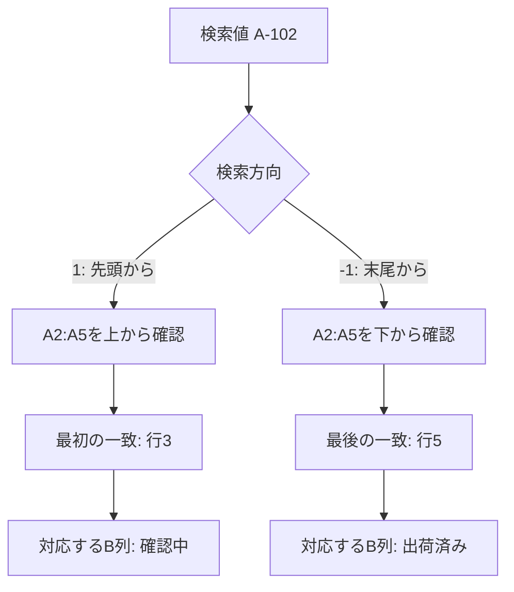

# ExcelのXLOOKUPで重複コードを検索｜最初と最後の一致を選ぶ方法

検証水準: 未実行。独立した論理審査を別途実施する。

# ExcelのXLOOKUPで重複コードを検索｜最初と最後の一致を選ぶ方法

> **この記事について**  
> この記事は、生成AIを活用した自動生成フローで作成しています。MicrosoftのXLOOKUP公式資料に基づき、検索方向を指定して重複コードの最初または最後の一致を返す方法を説明します。手元のExcelや例の数式での動作は実機確認していません。

**検証ステータス**：仕様確認済み（spec_checked）。公式資料の仕様を確認しています。数式例の実行は未確認です。

## 同じコードから、どの行の値を取得するか

商品コードや担当者コードが複数行にある表では、検索値が同じでも、先頭の行と最後の行で返す値が違うことがあります。XLOOKUPは既定で検索範囲の先頭から照合し、最初に見つかった一致を返します。最後にある一致を使うには、検索モードを末尾からの検索にします。

次の例では、コード `A-102` に対応する「状態」を取得します。表は2行目から始まり、コードがA列、状態がB列にあるものとします。検索値 `A-102` はE2に入力します。

| 行 | コード（A列） | 状態（B列） |
|---:|---|---|
| 2 | A-101 | 受付 |
| 3 | A-102 | 確認中 |
| 4 | A-103 | 完了 |
| 5 | A-102 | 出荷済み |

先頭の一致を返す式は次のとおりです。

```excel
=XLOOKUP(E2,A2:A5,B2:B5,"該当なし",0,1)
```

最後の一致を返す式は、最後の引数を `-1` にします。

```excel
=XLOOKUP(E2,A2:A5,B2:B5,"該当なし",0,-1)
```

**期待例（未実行）**：E2が `A-102` の場合、検索モード `1` は「確認中」、`-1` は「出荷済み」を返す想定です。ここでいう「最後」は、現在の検索範囲で最も下にある一致です。データ上の最新日時や、業務上の最終処理を自動判定しているわけではありません。

## 検索方向と返却される行を図で確認する

同じ検索値でも、検索方向によってどの一致を採用するかが変わります。次の図は、範囲を上から見る場合と下から逆向きに見る場合、それぞれで対応するB列の値が返る流れを示しています。



`1` では行3が先に見つかり、`-1` では下から探して行5が先に見つかります。XLOOKUPは一致した行に対応する戻り範囲の値を返します。図と結果は公式仕様に基づく説明であり、このブックを実際に操作して確かめた結果ではありません。

## 引数の対応をそろえて式を読む

XLOOKUPの引数は次の順です。

```text
XLOOKUP(検索値, 検索範囲, 戻り範囲, [見つからない場合], [一致モード], [検索モード])
```

今回の式では、`E2` が検索値、`A2:A5` がコードを探す検索範囲、`B2:B5` が返却値を取り出す戻り範囲です。`"該当なし"` はコードが見つからない場合に表示する値、`0` は完全一致、最後の `1` または `-1` は検索方向を表します。

検索範囲と戻り範囲は、行数だけでなく行の位置もそろえる必要があります。`A2:A5` の行を検索するなら、戻り範囲も同じ行に対応する `B2:B5` にします。片方だけが1行ずれていると、見つかったコードとは別の行の値を返す式になってしまいます。見出しを範囲に含めず、表の先頭と末尾が一致していることも確認してください。

まずE2に `A-102` を入れて式を入力します。次に、式の最後の引数だけを `1` から `-1` に変更します。検索値と範囲を固定したままなら、返却値の違いを検索方向の違いとして比較できます。数式をコピーして並べておけば、二つの結果を同時に見られます。

**期待例（未実行）**：E2を、1件だけ存在する `A-103` に変えると、検索モードが `1` と `-1` のどちらでも「完了」になる想定です。重複があるときだけ返却値が分かれることを比べると、検索モードが決めているのは一致の有無ではなく、複数の一致候補からどれを返すかだと分かります。

## 先頭一致・末尾一致以外の検索モード

検索モードを省略すると、XLOOKUPは先頭から検索します。明示的に `1` と書くと意図が式に残るため、あとで式を読む人が既定の動作に頼らず検索方向を判断できます。最後の一致を選ぶ `-1` は、データの並びを変えずに下から検索したい場面で使います。

検索モード `2` と `-2` は二分探索を指定します。二分探索は、範囲を半分ずつ絞って検索する方式です。Microsoftの公式資料では、`2` は昇順、`-2` は降順の並びを前提としており、範囲が整列されていない場合には無効な結果になり得ると説明されています。先頭や末尾の一致を選ぶだけなら、並べ替え前提のない `1` または `-1` のほうが用途を明確にできます。

二分探索を使うときは、検索範囲が常に指定の順序で保たれているかを確認してください。元データを並べ替えると、行順を使った別の計算や確認作業にも影響する場合があります。検索速度などの理由で二分探索を採用するなら、順序を維持する運用と、返却結果が業務上の並びの意味に合うことを合わせて検討します。

## 期待した値が返らない場合の確認点

式がエラーになる、または想定した行とは違う値が返る場合は、次の点を順に確認します。

1. **検索範囲と戻り範囲の行を確認する**  
   `A2:A5` と `B2:B5` のように、同じ行が対応しているかを見ます。範囲の開始行や終了行がずれていないかも確認します。

2. **検索値とコードの実データを確認する**  
   見た目が同じコードでも、一方が数値で一方が文字列として保存されていることがあります。また、コードの前後に空白があれば、期待した完全一致にならない場合があります。原本の列をすぐ一括変換せず、コピーした範囲で値や型を比べ、必要であれば別列に正規化したコードを用意してから照合します。

3. **検索モードが正しい位置にあるか確認する**  
   `1` / `-1` は6番目の引数です。5番目の一致モード `0` と位置を取り違えると、意図した検索方向になりません。式の後半が `...,0,1` または `...,0,-1` になっているかを確認します。

4. **数式の区切り記号とExcelの対応状況を確認する**  
   数式の引数を区切る記号は、地域設定などにより異なる場合があります。例ではカンマを使っていますが、入力時にエラーになる場合は手元のExcelで使われる区切り記号を確認してください。また、公式資料ではXLOOKUPはExcel for Microsoft 365やExcel 2021以降などに掲載され、Excel 2016とExcel 2019は非対応とされています。式を入力する環境だけでなく、共有先でも関数を認識できるかを確認します。

5. **「最後」が何を意味するかを決める**  
   `-1` が返すのは検索範囲内で最後に見つかる行です。行が日付順に保たれている保証がなければ、「末尾の一致」と「最新の一致」は同じではありません。最新のレコードを使う業務では、更新日時の列や並べ替えのルールが維持されているかを別に確認してください。

## 業務で使う前に決めておくこと

受付履歴のように同じコードが複数行へ現れる表では、先頭の状態を使うのか、末尾の状態を使うのかを業務ルールとして決めます。式を置く担当者だけが意図を把握している状態を避けるため、検索モードを明示し、見出しや隣接セルに「最初の行」「現在の並びで最後の行」など、返却値の意味を残すと引き継ぎやすくなります。

特に、表が後から並べ替えられるなら、`-1` の結果も変わる可能性があります。並び替え後にどの行が返るべきかを、ダミーの重複コードで確かめてから実表へ適用します。共有ブックでは、編集権限のある人が原本の並びやコード列を変更する可能性も考え、数式の結果だけで処理を確定せず、必要な確認欄や更新手順を設ける判断も有効です。

XLOOKUPを使えないバージョンが共有先に含まれる場合は、配布先のExcelで利用可能な検索方法を選ぶ必要があります。関数の互換性は、作成者側だけでなく閲覧・編集する側の環境で確認してください。ここでは代替式を示していないため、旧版との互換性が要件なら、対象バージョンを確定したうえで別途検証します。

## まとめ

重複コードの先頭行を返すなら検索モードに `1`、末尾行を返すなら `-1` を指定します。小さな表で重複があるケースと1件だけのケースを比べ、検索範囲と戻り範囲の対応、表の並び、返却値の業務上の意味を確認してから実データへ適用してください。二分探索の `2` / `-2` は並べ替えが前提になるため、先頭・末尾の一致を選ぶ用途とは分けて判断します。

## 公式情報・一次情報

- [XLOOKUP関数（Microsoft サポート）](https://support.microsoft.com/en-us/excel/functions/xlookup-function)
