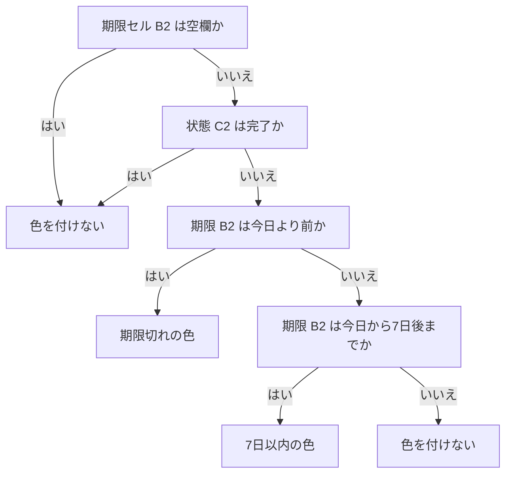

# 元ネタ参照メモ：Excel条件付き書式による期限切れ・7日以内・完了除外

検証水準: 未実行。独立した論理審査を別途実施する。

# 元ネタ参照メモ：Excel条件付き書式による期限切れ・7日以内・完了除外

> **この記事について**  
> この記事は、生成AIを活用した自動生成フローで作成しています。Microsoft Supportの条件付き書式に関する説明を確認し、数式ルールと適用範囲の考え方を整理しました。以下の数式例は資料に掲載されたものではなく、実機での動作確認もしていません。

**検証ステータス：spec_checked**  
公式資料の記載を確認しています。数式例は、指定した列配置を前提とする期待例です。対象のExcel環境や実際のブックでの動作は未確認です。

## 期限一覧を行単位で色分けする

Excelでタスクや申請の一覧を管理していると、「完了した行や期限が空欄の行は除き、未完了の行だけを期限切れと今後7日以内に分けたい」という場面があります。条件付き書式を数式で設定すれば、期限や状態の値に応じて色を変えられます。

例では次の列を使います。

| 列 | 内容 | 例 |
|---|---|---|
| A | タスク名 | 申請書の確認 |
| B | 期限 | 2026/10/22 |
| C | 状態 | 未完了／完了 |

この例では、データが2行目から始まるものとします。期限はExcelが日付値として認識していること、完了の表記は「完了」で統一されていることが前提です。実際の表では列や開始行、状態の表記に合わせて数式を調整してください。

Microsoft Supportによると、条件付き書式は範囲やテーブルなどに適用できます。数式を使うルールは `=` から始まり、数値・日付・時刻などを返す必要があります。数式が無効な場合、書式は適用されません。以下はそのルールに沿って構成した例であり、公式資料に掲載された数式そのものではありません。

## 判定順を決めてからルールを作る

色分けでは、まず「この行を判定対象にするか」を確認し、その後に期限を分類します。次の図は、この記事の例における判定順です。



この判定では、期限の空欄と完了を先に除外します。その後、「今日より前」を期限切れ、「今日以上かつ今日から7日後まで」を7日以内とします。したがって期限が今日なら、期限切れではなく7日以内の色になります。7日後ちょうども7日以内に含まれます。

## 数式ルールを設定する

期限切れ用の数式は次のとおりです。

```excel
=AND(ISNUMBER($B2),$C2<>"完了",$B2<TODAY())
```

今日から7日以内の期限用は、次の数式です。

```excel
=AND(ISNUMBER($B2),$C2<>"完了",$B2>=TODAY(),$B2<=TODAY()+7)
```

どちらも**期待例（未実行）**です。期限切れ側は期限が今日より小さい場合、7日以内側は期限が今日以上で今日から7日後以下の場合に成立します。範囲が重ならないため、この例では同じ行が両方の条件に該当することはありません。

`AND` は、括弧内の条件がすべて成立したときに真を返します。`ISNUMBER($B2)` は期限セルが数値かどうかを調べます。Excelでは日付は内部的に数値として扱われるため、日付値ならこの条件を満たします。日付に見えても文字列として保存された値は、日付としての比較が想定どおりにならないことがあります。

`$C2<>"完了"` は、状態が「完了」と一致しない行を対象にします。「済」や「完了済み」など別の表記を使っている場合は、式も実データの表記に合わせます。前後の空白や入力揺れがあると、意図した除外にならないことがあります。

`TODAY()` は数式を評価する時点の日付を返します。期限切れの定義を「今日を含む」にしたい場合は境界条件が変わります。ここでは「今日より前」と定義しているため、期限が今日の行は期限切れに入りません。

## 適用範囲と行番号を合わせる

タスク名から状態まで行全体に色を付ける場合、例として `A2:C100` を選び、数式を使う条件付き書式ルールを2つ設定します。それぞれに上の数式を登録し、異なる塗りつぶし色を割り当てます。期限セルだけを色付けする場合は、適用範囲を `B2:B100` にします。

数式の `$B2` は、列Bを固定して行番号は適用範囲に応じて変える参照です。`$C2` も列Cを固定し、行番号を変えます。適用範囲の先頭が2行目なら式の行番号も `2` にします。たとえば3行目では、相対的な行番号によりB3とC3が判定対象になります。適用範囲を `A2:C100` にしたのに式が `$B1` から始まっていると、各行の判定がずれる可能性があります。

設定後は条件付き書式のルール管理画面で、各ルールの数式と適用範囲を見直します。行を追加した後も適用範囲が新しい行まで及んでいるか確認してください。テーブルを使う場合も、追加行にルールが引き継がれるかは利用中のブックで確かめます。

## 境界を小さな表で確認する

今日を2026/10/24と仮定した場合の判定は次のとおりです。数式を評価した実測結果ではなく、境界を説明するための**期待例（未実行）**です。

| 期限 | 状態 | 期待される判定 |
|---|---|---|
| 2026/10/23 | 未完了 | 期限切れ |
| 2026/10/24 | 未完了 | 7日以内 |
| 2026/10/31 | 未完了 | 7日以内 |
| 2026/11/01 | 未完了 | 色なし |
| 2026/10/23 | 完了 | 色なし |
| 空欄 | 未完了 | 色なし |

実際のブックで確かめるときは、コピーした表または数行のダミー表を使います。期限を昨日、今日、7日後、その翌日にした未完了行と、完了行、期限が空欄の行を用意し、期待する判定と色が一致するかを確認します。`TODAY()` によって日付が変わるため、翌日以降に同じ表を確認すると判定も変化します。

## 色が付かない、または意図と違う場合

一部の行だけ反応しない場合は、適用範囲の先頭行と数式内の行番号が一致しているか、範囲の終端が必要な行まで含まれているかを見ます。期限欄が日付に見えても文字列の場合は、`ISNUMBER` が成立しない可能性があります。テスト用セルで期限を入力し直すか、値がExcelの日付として認識されているかを確認してください。

空欄に色が付く場合は、見た目が空でも数式が空文字を返している、あるいは空白文字が入っているなど、セルの実際の値を確認します。完了行に色が付くなら、状態が式の `"完了"` と完全一致しているかを確認します。余分な空白や「完了済み」といった別表記は一致しません。

数式が無効と表示される、または書式が適用されない場合は、先頭の `=`、括弧、セル参照を確認します。引数の区切り記号はExcelの設定によって異なることがあるため、入力中のExcelが受け付ける形式に合わせます。Microsoft Supportの説明はExcel for Microsoft 365を対象にしていますが、この記事の例を使う環境やブックでの動作は未確認です。

期限欄に時刻も含まれる場合、比較は日付だけでなく時刻部分にも影響されます。たとえば今日の日付の期限でも、時刻が現在時刻より前なら、数式上は `TODAY()` より大きい値です。そのためこの例の式では「今日より前」と判定されません。日付単位で管理するなら時刻を含めない運用にするか、時刻をどう扱うかを業務上決めたうえで式を設計します。

## 7日後を含めない定義に変える

「7日以内」を今日から7日未満と定義する場合は、7日以内ルールの最後を次のように変えます。

```excel
$B2<TODAY()+7
```

この変更では、今日から7日後ちょうどの期限が対象外になります。どちらの定義を採用するかは一覧の利用目的によります。たとえば「7日後の期限も事前確認の対象にする」なら `<=TODAY()+7`、「今日から7日未満だけを表示する」なら `<TODAY()+7` が意図に合います。担当者間で定義をそろえ、7日後当日の行で境界を確認してください。

## 実務で色を判断材料にする

申請一覧で色を使うと、担当者が確認の優先順位を付けやすくなります。一方、色だけでは期限値や完了状態が正しいかは分かりません。運用開始前に、状態の入力方法をそろえ、期限が日付値として保存されているかを確認します。データを取り込む一覧なら、取込後に文字列の日付や空白文字が混ざっていないかも少数の行で確認します。

色の見え方は画面や印刷によって異なり、色だけでは判別しづらい場合があります。期限列と状態列を残し、必要なら期限切れ・7日以内を示す補助列を用意すると、色に頼らず条件を確認できます。定期的に更新する一覧では、行の追加後に適用範囲が追随するか、境界の日付が正しい色になるかを担当者が確認できる手順にしておくと、ルールのずれに気付きやすくなります。

## まとめ

空欄と完了を除外しながら期限を色分けするには、対象行の条件と日付の境界を数式で明示します。まず昨日・今日・7日後・その翌日、完了、空欄のダミー行で判定を確かめ、次に適用範囲の開始行、数式の行番号、状態表記、日付値を確認してください。運用に入れる前に、「7日後当日を含めるか」と、期限に時刻を含めるかを決めておくと、色の意味を担当者間で共有できます。

## 公式情報・一次情報

- [Excelで条件付き書式を使用して情報を強調表示する（Microsoft Support）](https://support.microsoft.com/en-us/excel/use-conditional-formatting-to-highlight-information)
