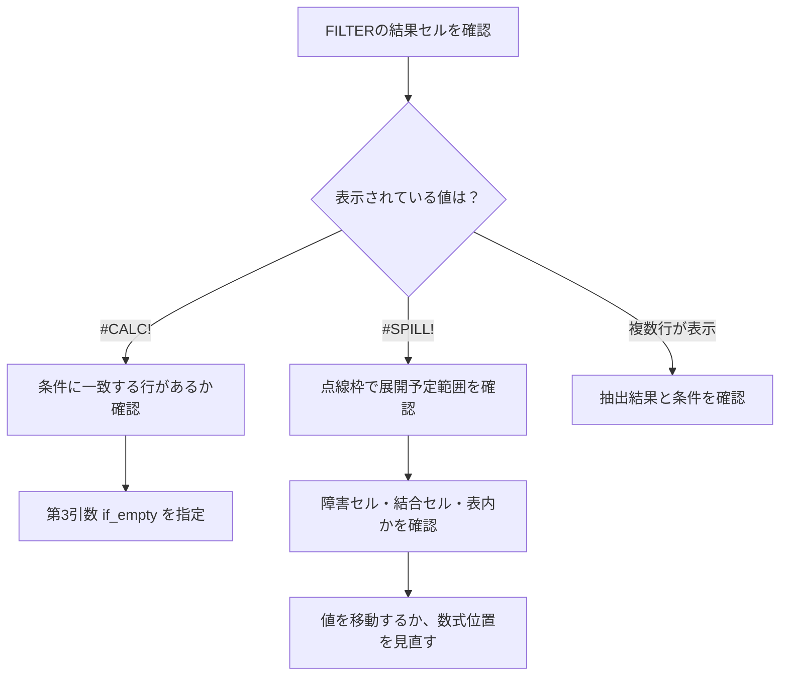

# Excel FILTERで0件と#SPILL!を区別する

検証水準: 未実行。独立した論理審査を別途実施する。

# Excel FILTERで0件と#SPILL!を区別する

> **この記事について**  
> この記事は、生成AIを活用した自動生成フローで作成しています。MicrosoftのFILTER関数と#SPILL!エラーに関する公式資料を確認し、0件時の戻り値と展開範囲の障害を切り分ける手順を整理しました。実機での操作や画面表示は確認していません。  
> **検証ステータス：spec_checked（Microsoft公式資料を確認。実機未確認）**

FILTERの結果が見えないときは、まず数式セルに表示されている値を確認します。`#CALC!`なら該当なし時の戻り値、`#SPILL!`なら結果を置く範囲を調べます。どちらも「抽出できなかった」とまとめてしまうと、直す場所を誤ります。

## まずエラー表示で確認先を分ける

この図は、セルにFILTERを入力した後の最初の切り分けを示します。正常に複数行が返る場合も含め、エラーの種類ごとに次の確認先が異なります。



`#CALC!`は、条件に一致する値がなく、空の配列を返そうとしたケースが代表例です。一方、`#SPILL!`は複数の結果をワークシート上に配置できないときに発生します。まずエラー表示を見てから、該当する枝の確認へ進みます。

## 0件のときは第3引数を指定する

FILTERの基本形は次のとおりです。

```excel
=FILTER(array,include,[if_empty])
```

`array`は抽出対象、`include`は各行を含めるかどうかを示す条件です。`if_empty`は任意の第3引数で、条件に一致する値がない場合に返す値を指定します。Excelは空配列を現在サポートしていないため、該当なしになる可能性がある数式では、この引数を指定します。[MicrosoftのFILTER関数の説明](https://support.microsoft.com/en-us/excel/functions/filter-function)

次の例では、A5:D20のデータから、C列がH2と一致する行を抽出します。

```excel
=FILTER(A5:D20,C5:C20=H2,"")
```

最後の`""`が第3引数です。一致する行がなければ空文字列を返します。実際にセルが空になるのではなく、数式の結果として空文字列が返る点に注意してください。0件を明示したいなら、たとえば`"該当なし"`のような文字列に変える方法もあります。

```excel
=FILTER(A5:D20,C5:C20=H2,"該当なし")
```

これは「抽出条件が正しい」ことを保証するものではありません。条件の入力ミスや、比較対象の空白・表記揺れで0件になっている可能性もあります。まずH2の値とC列の実データを照合し、意図した条件になっているか確認してください。条件配列に別のエラー値が含まれる場合、FILTER自体がエラーを返すこともあります。

### 第3引数を変えて違いを見る

同じ式の第3引数だけを変えると、0件時の表示をどう扱うか確認できます。

| 第3引数 | 0件時に返す値 | 向いている用途 |
|---|---|---|
| `""` | 空文字列 | 結果欄を目立たせたくない |
| `"該当なし"` | 説明文字列 | 0件を利用者に明示したい |
| 省略 | 空配列を返そうとし、`#CALC!`になる場合がある | 0件が起きないことを別途保証できる場合 |

期待例（未実行）として、H2をC列に存在しない値に変えた場合、`""`なら結果セルは空文字列を表示し、`"該当なし"`ならその文字列を表示します。条件を変えて試すときは、検索値だけを変え、数式の範囲や条件列はそのままにすると比較しやすくなります。

## #SPILL!は結果を置く場所を調べる

FILTERは複数行・複数列の配列を返すことがあります。数式が最終結果としてセルに入力されている場合、Excelは結果を隣接セルへ展開します。この展開先に既存の値や結合セルがあると、配列をグリッドへ配置できず`#SPILL!`になることがあります。[Microsoftの#SPILL!エラー対処](https://support.microsoft.com/en-us/excel/how-to-correct-a-spill-error)

まずエラーセルを選択し、表示される点線枠で展開予定範囲を確認します。次にエラーチェックのメニューから「障害セルの選択」を選べる場合は、どのセルが展開を妨げているかを特定します。画面の名称や操作方法はExcelの環境によって異なる可能性があり、ここでは各環境での表示を実機確認していません。

障害セルに値や数式がある場合は、内容を確認してから移動または削除します。業務ブックでは、単に消すのではなく、その値が必要なデータではないか、数式の結果ではないかを先に確認してください。展開先を空けられない場合は、FILTERの数式を別の空き領域へ移す方法があります。

空白に見えるセルが原因とは限りません。次のような条件も確認します。

| 確認箇所 | 起きること | 対処の考え方 |
|---|---|---|
| 展開予定範囲内のセル | 値や数式が展開を妨げる | 内容を確認して移動するか、数式の配置を変える |
| 結合セル | 配列を展開できない | 結合を解くか、結合セルにかからない位置へ移す |
| Excelテーブル内 | スピル配列数式はテーブル内でサポートされない | 数式をテーブルの外へ置く |
| シートの端 | 必要な結果がワークシートの範囲を超える | 対象データや数式の位置を見直す |
| 配列サイズが安定しない数式 | 再計算の間に結果サイズが変わり続ける | 揮発性関数の利用や配列サイズの決め方を見直す |

空きセルを探すときは、展開予定範囲を目で追うだけでなく、障害セルの選択機能が使えるか確認すると特定しやすくなります。テーブル内の数式が原因なら、テーブルを安易に通常範囲へ変換する前に、構造化参照や表の設計を維持できる別の配置を検討します。

## 「結果がない」と「置けない」を混同しない

0件と`#SPILL!`では、調査対象が違います。

- `#CALC!`なら、条件に一致する行があるか、`if_empty`が指定されているかを確認する。
- `#SPILL!`なら、数式の条件を変える前に、点線枠で示される展開予定範囲と障害セルを確認する。
- 結果が表示されているなら、抽出行と条件値が業務上の意図に合っているかを確認する。

特に集計・照合用のブックでは、空文字列を返す設定が「データなし」と「数式が表示上空」を同じ見た目にしてしまう場合があります。後続の数式や帳票が0件を判定する必要があるなら、`"該当なし"`など明示的な表示にするか、判定用のセルを別に設ける設計が適しています。反対に、表示欄の見た目を優先するなら空文字列が扱いやすいことがあります。

もう1つ、結果が空に見える場合は、数式セルと展開先を分けて考えます。第3引数に`""`を指定して0件になったときは、結果を置けない障害が起きたわけではなく、FILTERが指定どおり空文字列を返しています。数式バーで数式を確認し、H2の検索値やC列の値を照合すると、「一致する行がない」のか「表示上は空にしている」のかを判断しやすくなります。

反対に、`#SPILL!`が表示されている場合、条件を変えて0件にすれば一時的にエラー表示が消えることがあります。しかし、それだけでは展開先の問題が解決したとは限りません。検索値を元に戻したときに複数行が返るなら、同じ場所で再び展開できなくなる可能性があります。先に展開先を調べ、抽出条件の確認と配置の修正を別々に行うと、原因を混同しません。

## 仕事のブックへ適用するときの確認順

受注一覧や問い合わせ一覧のように、検索条件によって該当行数が変わる表では、結果が1件だけとは限りません。数式を置く前に、結果が広がる範囲を見込み、既存データや別の数式と重ならない位置を確保します。元データの行数が増える運用なら、将来の結果が増えても展開先に収まるかも確認します。

安全に試すには、まずコピーしたブック、またはダミーの小さな表を使います。A5:D20に数行のサンプルを置き、C列に同じ値が複数あるケースと、H2に一致しない値を入れるケースを用意します。最初は空いている場所に式を置き、0件時は第3引数を変えた表示を比較します。次に、数式の下や右にダミー値を置き、複数行が返る条件にして`#SPILL!`が起きる状況を確認します。これは記事執筆時に実行した検証ではなく、読者が挙動を確かめるための手順です。

試した後は、置いたダミー値を消し、数式の位置と参照範囲を元の用途に合わせます。実務データを含むブックでいきなりセルを削除すると、抽出結果の障害とは無関係な入力値まで失うおそれがあります。障害セルに既存の値がある場合は、別の空き領域へ数式を移すか、業務上の所有者に値の移動可否を確認してから変更します。

結果が大きくなる可能性がある一覧では、出力場所を固定できるかも判断材料です。表の中に計算列を持たせたい用途と、FILTERのように結果行数が変化する抽出一覧は相性が異なります。テーブルの構造化参照を保ちたい場合でも、スピル結果の置き場所はテーブルの外に用意する設計が必要です。帳票の決まった領域に結果を収める必要があるなら、最大件数やページ分割、抽出後の確認手順まで決めてから式を配置します。

### 変更するのは検索値か、配置か

原因を切り分けるときは、一度に複数の要素を変えないことが大切です。0件の確認ではH2だけを一致しない値に変え、第3引数の表示を見ます。展開エラーの確認では条件を複数行が返る値に保ち、数式の周囲に障害となるセルがないかを調べます。検索値と出力位置を同時に変えると、エラーが消えてもどちらが原因だったか分からなくなります。

変更後は、元の検索値に戻したときに期待する件数が返るか確認します。0件を意図したテストと、複数件を表示する通常ケースの両方を確認すれば、空文字列でエラー表示を隠しているだけなのか、配置も含めて使える状態なのかを見分けられます。共有ブックや定期更新する帳票に適用する場合は、入力担当者が0件をどう判断するか、数式の出力先を誰が編集できるかも決めておくと、後から障害セルが追加されるリスクを減らせます。

## まとめ

FILTERの結果が0件なら第3引数`if_empty`と検索条件を確認し、`#SPILL!`なら展開予定範囲の障害を確認します。空文字列は表示を空にできますが、利用者が0件と気づきにくくなる場合があります。ダミー表で検索値と出力位置を別々に変え、期待される表示と展開範囲を確かめてから、実務のブックへ適用してください。

## 公式情報・一次情報

- [FILTER関数（Microsoft サポート）](https://support.microsoft.com/en-us/excel/functions/filter-function)
- [#SPILL!エラーを修正する（Microsoft サポート）](https://support.microsoft.com/en-us/excel/how-to-correct-a-spill-error)
