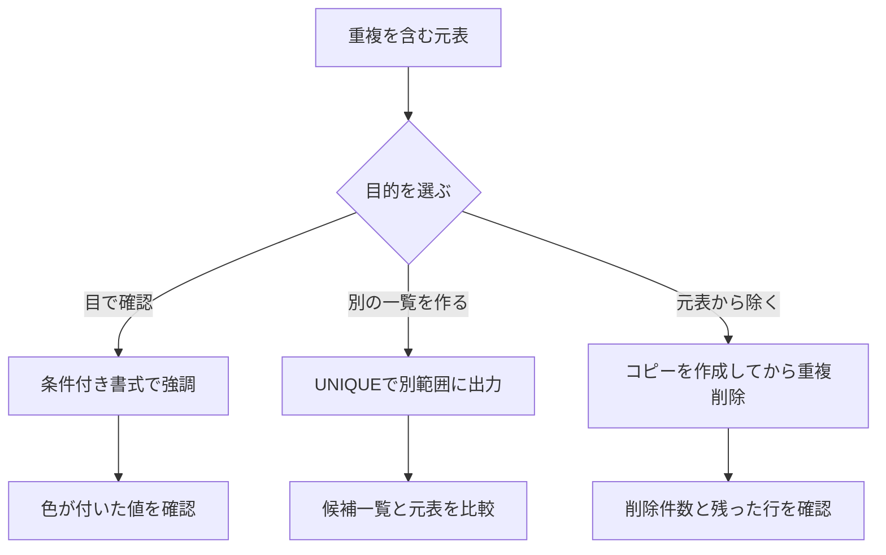

# 元ネタ参照メモ：Excelの重複強調・UNIQUE・重複削除を区別

検証水準: 未実行。独立した論理審査を別途実施する。

# 元ネタ参照メモ：Excelの重複強調・UNIQUE・重複削除を区別

> **この記事について**  
> この記事は、生成AIを活用した自動生成フローで作成しています。Microsoft Supportの「重複の検索と削除」をもとに、重複の強調表示、UNIQUE関数による別一覧の作成、重複データの削除を用途別に整理します。Excelの画面操作と結果は未検証です。
>
> **検証ステータス：spec_checked（公式資料を確認。Excelでの実機操作は未確認）**

名簿や商品一覧で同じ値を見つけても、すぐ削除してよいとは限りません。色を付けて確認したいのか、原本を残して候補一覧を作りたいのか、元データから行を除きたいのかで、選ぶ機能が変わります。

ここでは、A列に「商品コード」、B列に「商品名」がある表を例にします。重複判定の基準が商品コードなのか、行全体なのかを先に決めてください。見た目が似た値でも、余分な空白などが含まれていれば別の値として扱われる場合があります。

## 3つの方法は、元データへの作用が違う

次の図は、同じ表から目的別に進む流れを示しています。強調表示とUNIQUEは元表を残したまま結果を確認できますが、重複の削除は元表からデータを取り除きます。



この3つは同じ「重複対策」でも、結果の置き場所と元表への影響が異なります。最初は元表を変えない方法で候補を確認し、削除が必要だと判断した段階で、コピーに対して削除を試すと戻しやすくなります。

| 方法 | 元表への影響 | 向いている場面 |
|---|---|---|
| 条件付き書式 | 値を残したまま色で示す | 重複箇所を目で見て確認する |
| `UNIQUE` 関数 | 元表を残して別範囲に一覧を作る | 集計用・確認用の候補一覧を作る |
| 重複の削除 | 元表から重複行を削除する | 確認後に一覧を整理する |

## まず重複箇所を色で確認する

どの行が重複しているかを目で見たいときは、条件付き書式を使います。対象の列または範囲を選択して、Excelの **ホーム** タブから **条件付き書式**、**セルの強調表示ルール**、**重複する値** の順に選びます。表示される設定で書式を選ぶと、重複値が色で示されます。

たとえば商品コード列だけを選べば、同じコードが複数ある場所を確認できます。コードだけでなく商品名も含めた行全体の組み合わせが重複しているかを調べたい場合、コード列だけにこのルールを適用しても、その問いには答えられません。どの列を対象にしたかを、確認する人が分かるようにしておきましょう。

色が付いたセルは「削除してよい行」を意味しません。正当な再登録や同じ商品を複数行で管理しているケースもあり得ます。色は候補を見つける手がかりとして使い、元データや登録ルールと照合してください。

## 原本を残して候補一覧を作る

重複を除いた一覧を別の場所に作るなら、対象の列の空いているセルに `UNIQUE` 関数を入力します。たとえばA2:A8を対象にする場合は、次の式が候補一覧になります。

```excel
=UNIQUE(A2:A8)
```

この式は指定範囲から一意の値を返し、結果を下方向へ展開します。結果が表示される先に既存の値があると展開できないことがあるため、出力先を空けておきます。元表はそのままなので、一覧を照合したり、別の集計に利用したりできます。

**期待例（未実行）**：A2:A8に `P-01`、`P-02`、`P-01` が含まれる場合、出力候補には `P-01` と `P-02` がそれぞれ1回ずつ表示されます。これは式の説明に基づく期待例であり、ここでExcelを操作した実測結果ではありません。

並べ替えた候補が必要なら、次のように `SORT` と組み合わせます。

```excel
=SORT(UNIQUE(A2:A8))
```

ここで行っているのは一覧の作成であり、元表から行を消す処理ではありません。既存のデータを保持したまま候補を作る用途に向きます。Excelのエディションやバージョンによる `UNIQUE` の対応状況は、確認済み資料では網羅されていません。式が使えない環境では、利用中のExcelで関数の対応を確認してください。

なお、この式は「重複を含む値を一覧から一つにまとめる」用途のものです。どの行を残すか、他の列の情報をどう扱うかまで自動で判断するものではありません。たとえば同じ商品コードに異なる商品名が対応していたら、候補一覧だけを見て片方を消さず、元表で対応関係を確認します。

## 元表から削除する前にコピーを作る

重複データを元表から取り除くには、**データ** タブの **重複の削除** を使います。Microsoft Supportは、重複の削除によってデータが完全に削除されるため、実行前に元データを別の場所へコピーまたは移動することを勧めています。

手順は次のように進めます。

1. 元表を別シートまたは別ファイルへコピーし、コピー側を作業対象にします。
2. コピー側の表内を選び、**データ** タブから **重複の削除** を開きます。
3. 見出し行の有無を確認し、重複判定に使う列を選びます。
4. 削除後に表示される件数と、残った行の内容を確認します。

重複判定に使う列の選択は重要です。商品コードと商品名の両方にチェックを入れると、両列の値が同じ行を重複として扱う条件になります。コードだけを基準にするなら、コード列だけを選びます。ただし同じコードに複数の商品名がある場合、どの行が残るべきかは業務ルールで決める必要があります。削除操作だけでは、商品情報の正しさまでは判断できません。

実行前に、表のアウトラインや小計が設定されている場合は外してください。削除件数だけで完了とせず、コピーした元データと削除後の表を比較し、必要な行まで消えていないかを確認します。誤りがあれば、作業コピーを破棄して元データからやり直せます。

## 件数が想定と合わないときに見るもの

削除後の件数は、重複判定に使った列と元データの状態で変わります。商品コードを基準にしたのか、商品コードと商品名の組み合わせを基準にしたのかを見直してください。

また、空白セルや、値の前後に入ったスペースなどがあると、予想と異なる候補や件数になる場合があります。空白を含む値は、見た目だけで同じかどうか判断しにくいことがあります。削除前に対象列を確認し、スペースを取り除くなどのデータ修正を行う場合は、必ずコピー上で実施してから差分を確認します。今回確認した資料からは、空白やスペースを扱う詳細な判定条件までは分からないため、実際の結果と元データを照合してください。

| 起きたこと | 確認する点 |
|---|---|
| 削除後の件数が予想と違う | 判定列の選択、見出し行の指定、空白セルやスペース |
| 別の商品名の行が残らない | 商品コードだけを判定条件にしたか、残す行の業務ルール |
| UNIQUEの結果が表示されない | 出力先に値があり、結果の展開を妨げていないか |
| 色が付いた行を消してよいか迷う | 重複が許される業務上の理由がないか、元データと照合 |

## 業務では「検出」「一覧化」「削除」を分ける

定期的に受け取る名簿や商品マスターでは、条件付き書式で候補を見つけ、`UNIQUE` で別一覧を作って内容を確認する流れが安全です。元表を直接変更せずに確認できるため、登録漏れや表記違いの調査にも使えます。

一方、重複の削除は、判定キーと残す行のルールが決まってから実行します。担当者が複数いる表なら、「商品コードが同じ行は一つにする」だけでなく、更新日が新しい行を残すのか、必要項目がそろった行を残すのかも決めておきます。条件が決まらない段階では、削除せず候補一覧で確認を続けるのが適切です。

## まとめ

重複を色で確認する、原本を残して別一覧にする、元表から削除する、という3つは目的が異なります。最初に判定する列と目的を決め、候補の確認には条件付き書式や `UNIQUE` を使い、削除するときはコピー上で列の選択と削除後の内容を確認してください。

### 公式情報・一次情報

- [Microsoft Support：重複の検索と削除](https://support.microsoft.com/en-us/excel/find-and-remove-duplicates)
