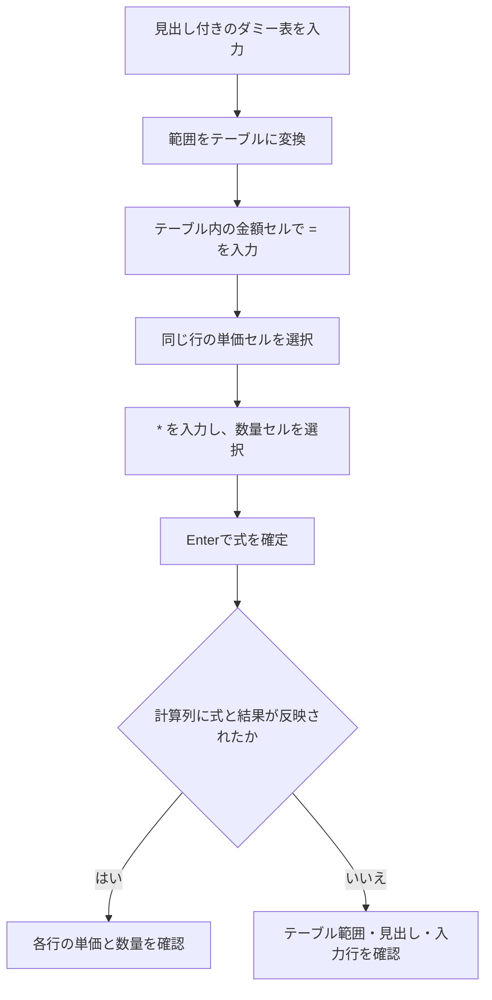

# 元ネタ参照メモ：Excelテーブルの構造化参照と行の追加

検証水準: 未実行。独立した論理審査を別途実施する。

# 元ネタ参照メモ：Excelテーブルの構造化参照と行の追加

> **この記事について**  
> この記事は、生成AIを活用した自動生成フローで作成しています。Microsoft Supportの構造化参照に関する資料をもとに、数式への入力方法、計算列、列見出しや行数の確認点を説明します。Excelの実機操作は未確認です。
>
> **検証ステータス：spec_checked（Microsoft Supportの仕様を確認。実機での操作・表示は未確認）**

Excelテーブルの列を数式で参照するとき、セル番地の代わりに列見出しを使う方法が「構造化参照」です。式を入力する際にテーブル内のセルを選ぶと参照を挿入でき、テーブル内の計算列では式を列全体へ反映できます。

この記事では、ダミーの売上一覧を使い、構造化参照を式へ入れる手順と、期待どおりに計算されないときの確認箇所を見ていきます。以下の操作例と結果は、Microsoft Supportの説明に基づく期待例であり、実機での実測結果ではありません。

## まず作る小さな売上一覧

新しいシートに、次の表を入力します。既存のブックを変更せずに試すなら、空のシートを追加するか、新しいブックを使ってください。

| 商品 | 単価 | 数量 |
|---|---:|---:|
| ノート | 120 | 3 |
| ペン | 80 | 5 |

表の範囲内を選び、Excelの「テーブルとして書式設定」からテーブルにします。作成時に「先頭行をテーブルの見出しとして使用する」を有効にします。これにより、1行目の「商品」「単価」「数量」が列見出しになります。

テーブル内のセルを選ぶと、リボンにテーブル関連のタブが表示されます。テーブル名はそのタブで確認・変更できます。ここでは例として `売上一覧` とします。実際の画面上のタブ名や配置は、Excelの版によって異なる場合があります。

テーブルを作成したら、「金額」列を追加します。テーブル右端の見出しセルに `金額` と入力すると、その列がテーブルに含まれます。次に、データ行の「金額」列のセルを選んで数式を入力します。

## セルを選んで構造化参照を入れる

数式は次の形です。

```excel
=[@単価]*[@数量]
```

`@` は、テーブルの中で数式を入力している「この行」を表します。したがって、1行目では `120 × 3`、2行目では `80 × 5` が計算されます。

式を手入力する代わりに、数式バーまたはセルで `=` を入力したあと、同じ行の「単価」セルをクリックします。続けて `*` を入力して「数量」セルをクリックし、Enterキーを押します。テーブル内のセルを選択して式を作ることで、Excelが構造化参照を挿入します。

操作の流れと、各段階で確かめる点を図にしました。計算列の式が入力できた後は、各データ行に結果が表示されるかを確認します。



この図は入力から確認までの順序を示しています。正常なら、金額列には先頭行で `360`、次の行で `400` が表示されると期待されます。実際にその値が出るかは、利用するExcelで確認してください。

計算列では、テーブル内の1つのセルに式を入力すると、同じ列のほかの行にも式がコピーされます。行ごとに式をコピーして範囲を調整する作業を減らせるのが利点です。列の式が一部の行にしか入らない場合は、入力したセルがテーブル内か、データ行が複数あるかを先に確認します。

## テーブルの外から参照する場合

テーブル外のセルで同じ列を参照する場合は、テーブル名を含めます。たとえば、テーブルの金額列を合計する式は次の形です。

```excel
=SUM(売上一覧[金額])
```

`売上一覧` がテーブル名、`金額` が列見出しです。テーブル内の「この行」を参照する `[@単価]` とは用途が異なります。テーブル内の計算列では行ごとの値を参照し、テーブル外の集計式ではテーブル名と列名で列を指定します。

ここで条件を1つ変えて、テーブルに3行目の商品を追加します。追加行の「単価」と「数量」を入力したとき、計算列に式が入るか、テーブル外の合計式が追加行を含むかを確認してください。Microsoft Supportの説明では、構造化参照はテーブルのデータが追加・削除されたときに調整されます。ここで示した追加後の表示は期待例であり、個別のファイルや設定での実測ではありません。

## 式が反映されないときに見る場所

**列見出しと式の参照が一致しているか**  
構造化参照は列見出しを使います。たとえば式が `[@数量]` を参照しているのに、見出しが「個数」なら、名前が一致しません。まず数式バーで式を確認し、テーブルの見出しセルに余分な空白や異なる文字がないか見ます。見出しを変更した後は、式が期待する列を参照しているかも確かめてください。

**見出しに空白や記号が含まれていないか**  
列見出しに特殊文字が含まれる場合、参照の表記に追加の角括弧やエスケープが必要になることがあります。式がエラーになる場合は、角括弧の対応を確認し、参照を手入力するより、数式の編集中に対象セルを選んでExcelに参照を挿入させる方法を試します。見出しの具体的な文字によって表記が変わるため、すべての特殊文字について同じ書き方が使えるとは限りません。

**テーブルにデータ行が何行あるか**  
1行だけのテーブルでは、式を先に作ってから行を追加すると、予期しない計算結果になる場合があるとMicrosoft Supportは説明しています。まず見出し行だけの状態で式を用意していないかを確認し、少なくとも複数のデータ行がある状態で、式と追加行の動きを確かめてください。結果が合わないときは、セル番地の式と構造化参照を混在させていないか、参照先の列と対象行が意図どおりかも見ます。

**式を入れたセルがテーブルの内側か**  
テーブルの外に式を入力した場合、計算列として自動的に列全体へコピーされるわけではありません。テーブルの枠内を選び直し、意図した列のデータ行へ式を入れているか確認します。テーブルの範囲は、テーブル内のセルを選んだときに表示されるテーブル関連の操作から確認できます。

## 業務で使う前の確認

構造化参照は、行の増減がある一覧で列の意味を保ったまま式を管理したいときに向いています。たとえば、定期的に明細が追加される表で、単価と数量から金額を計算する場合です。列名で式を読めるため、`=B2*C2` のようなセル番地の式より、参照の意味を把握しやすくなります。

ただし、見出し名を変える運用がある場合や、同じブックを異なるExcelの版で使う場合は、式の表示と計算列への反映を実際の環境で確認してください。Microsoft Supportの対象製品として、Excel for Microsoft 365、Excel for Microsoft 365 for Mac、Excel 2024 for Mac、Excel 2021 for Macなどが挙げられていますが、ここで使った資料からは、各版のライセンス差や画面差までは確認できません。

## まとめ

まず新しいシートで小さな表をテーブルに変換し、計算列のセルを選んで数式を作ります。式が反映されないときは、列見出しと式の名前、特殊文字を含む見出し、テーブル内外の位置、データ行の数を確認してください。行を1つ追加した後にも、計算列とテーブル外の集計式が意図した範囲を参照しているか確かめると、実務の表へ適用する判断材料になります。

### 公式情報・一次情報

- [Microsoft Support：Excel テーブルで構造化参照を使用する](https://support.microsoft.com/en-us/excel/using-structured-references-with-excel-tables)
