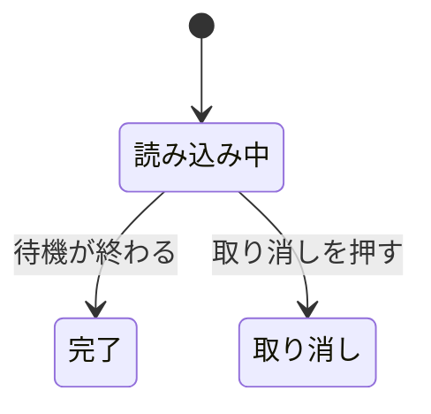

# 遅い読み込みを取り消して待機表示を解除する｜AbortController

読み込み中に方針が変わったときは、待ち続ける必要がありません。中止の通知を処理へ渡し、画面を待機状態から戻します。

## 最初に知っておく用語

- **シグナル**は、中止を伝える目印です。
- **AbortController**は、処理へ中止を知らせる仕組みです。

## 状態遷移図で考える

同じ読み込み中の画面から、完了と取り消しの二つが分かれます。

## ライブデモ

[公開用ライブデモ](https://papanda925.github.io/Daily-Code-Samples/demos/abortcontroller-cancel-wait/#live) ／ [実装HTML](../../docs/demos/abortcontroller-cancel-wait/index.html) ／ [共通JavaScript](../../docs/demos/browser-library-labs/daily.js)

1. 現行のブラウザーでデモを開く。Mermaidの描画や一部のライブラリーに外部通信を使用する。
2. 「実行」を押す。下記の値や画面内の操作欄を試す。

読み込みを開始してすぐ取り消す。次は完了まで待つ。

### 結果の見方

中止と完了を別々に表示する。

待ち時間は約1.8秒。開始直後に押すと取り消しが先に成立する。連続して開始した場合は古い処理の結果で新しい表示を書き換えない。

## コードの要点

待機処理に中止のシグナルを渡します。取り消しボタンの abort() で待機を終えます。実際の通信では同じ signal を fetch のオプションへ渡せます。

実装はデモ画面の「実装コード」で確認できます。

## 仕事で使うとき

通信を中止しても、送信先で確定した処理は残る場合がある。

## 参考資料

- [AbortControllerの参照資料](https://developer.mozilla.org/en-US/docs/Web/API/AbortController)
- [Mermaidの図の書き方](https://mermaid.js.org/intro/syntax-reference.html)

本文はAIを利用して作成しました。

## 実行環境と検証

Node.jsで実行処理を確認した。 Pagesでの各機能の実行とMermaidの描画は検証範囲に含まれていない。

図が表示されない場合は、本文の読み方とMermaidソースを参照する。デモ欄に取得エラーが出る場合は通信条件を確認する。検証用の架空データを使う。
