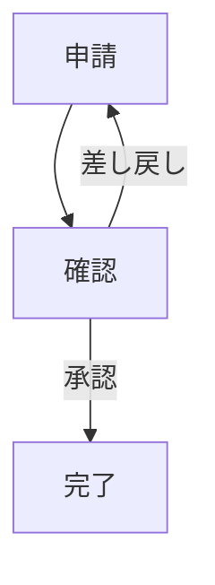

# 業務フローの差し戻し経路を保存する｜bpmn-js

申請を差し戻す場合は、誰が手順をやり直すか示す必要があります。二つの箱を結び、図を保存してから戻り先を確かめます。

## 最初に知っておく用語

- **BPMN**は、業務手順を共通の記号で表す規格です。
- **XML**は、要素と属性でデータを表す形式です。

## フローチャートで考える

確認から申請に戻る矢印を探します。フォームの記入者に何が戻るかを検討できます。

## ライブデモ

[公開用ライブデモ](https://papanda925.github.io/Daily-Code-Samples/demos/bpmn-return-flow/#live) ／ [実装HTML](../../docs/demos/bpmn-return-flow/index.html) ／ [共通JavaScript](../../docs/demos/browser-library-labs/daily.js)

1. 現行のブラウザーでデモを開く。Mermaidの描画や一部のライブラリーに外部通信を使用する。
2. 「実行」を押す。下記の値や画面内の操作欄を試す。

図の「申請」をダブルクリックして編集する。保存・再読込を押す。

### 結果の見方

名前と差し戻し経路が復元される。

差し戻しの線がどこに戻るか確認する。図を保存して開き直した後も、戻り先とラベルが維持されるかを見る。

## コードの要点

saveXML で編集中の図を XML に変えます。importXML で読み込み直し、図の表示と書き出した結果を確認します。

実装はデモ画面の「実装コード」で確認できます。

## 仕事で使うとき

保存ファイルを受け取る担当者と、使う記号の範囲をそろえる。

## 参考資料

- [bpmn-jsの参照資料](https://github.com/bpmn-io/bpmn-js)
- [Mermaidの図の書き方](https://mermaid.js.org/intro/syntax-reference.html)

本文はAIを利用して作成しました。

## 実行環境と検証

JavaScriptの構文とファイル間の対応を確認した。 Pagesでの各機能の実行とMermaidの描画は検証範囲に含まれていない。

図が表示されない場合は、本文の読み方とMermaidソースを参照する。デモ欄に取得エラーが出る場合は通信条件を確認する。検証用の架空データを使う。
