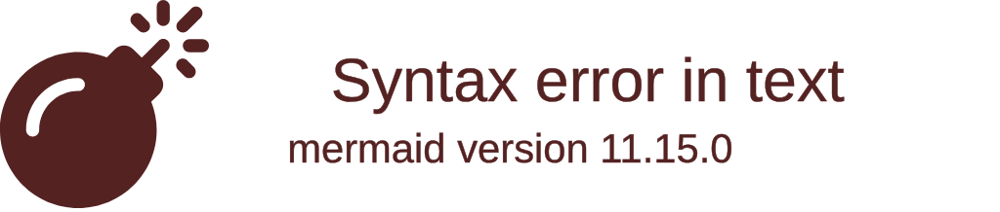

# 同じサイトの別タブに表示テーマを伝える｜BroadcastChannel

同じサービスを二つのタブで開いた場合に、設定の変更を伝えたいことがあります。配色のライトとダークをメッセージで送って比べます。

## 最初に知っておく用語

- **チャネル**は、メッセージをやり取りする経路です。
- **ブロードキャスト**は、同じ経路を購読する相手に配信することです。

## アーキテクチャ図で考える

同じ枠の中がメッセージをやり取りする範囲です。二つのタブが同じ名前のチャネルを開きます。

## ライブデモ

[公開用ライブデモ](https://papanda925.github.io/Daily-Code-Samples/demos/broadcastchannel-theme/#live) ／ [実装HTML](../../docs/demos/broadcastchannel-theme/index.html) ／ [共通JavaScript](../../docs/demos/browser-library-labs/daily.js)

1. 現行のブラウザーでデモを開く。Mermaidの描画や一部のライブラリーに外部通信を使用する。
2. 「実行」を押す。下記の値や画面内の操作欄を試す。

同じデモを2タブで開く。片方でテーマ名を送る。

### 結果の見方

先に開いているタブに配色が伝わる。

送信ボタンを押したタブにも同じ設定を適用する。相手タブは受信処理で反映する。後から開いたタブは過去のイベントを受け取らない。

## コードの要点

同名のチャネルで postMessage し、受信するタブで配色を変更する。

実装はデモ画面の「実装コード」で確認できます。

## 仕事で使うとき

後から開くタブにも最新値を出す場合は、値を別途保存する。

## 参考資料

- [BroadcastChannelの参照資料](https://developer.mozilla.org/en-US/docs/Web/API/BroadcastChannel)
- [Mermaidの図の書き方](https://mermaid.js.org/intro/syntax-reference.html)

本文はAIを利用して作成しました。

## 実行環境と検証

JavaScriptの構文とファイル間の対応を確認した。 Pagesでの各機能の実行とMermaidの描画は検証範囲に含まれていない。

図が表示されない場合は、本文の読み方とMermaidソースを参照する。デモ欄に取得エラーが出る場合は通信条件を確認する。検証用の架空データを使う。
