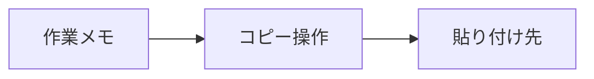

# 整形した作業メモを一操作でコピーする｜Clipboard API

作業メモを毎回選択してコピーする操作は手数がかかります。ボタンで整形済みの文をコピーし、貼り付けて確かめます。

## 最初に知っておく用語

- **クリップボード**は、コピーしたデータを一時的に保持する場所です。
- **セキュアコンテキスト**は、通常はHTTPSやlocalhostで提供される安全な実行環境です。

## 処理のフローチャートで考える

左から右に読みます。「コピー操作」が変わると「貼り付け先」にどう影響するかを予想します。

## ライブデモ

[公開用ライブデモ](https://papanda925.github.io/Daily-Code-Samples/demos/clipboard-work-note/#live) ／ [実装HTML](../../docs/demos/clipboard-work-note/index.html) ／ [共通JavaScript](../../docs/demos/browser-library-labs/daily.js)

1. 現行のブラウザーでデモを開く。Mermaidの描画や一部のライブラリーに外部通信を使用する。
2. 「実行」を押す。下記の値や画面内の操作欄を試す。

コピーを押す。貼り付け欄で結果を見る。

### 結果の見方

対応環境では整形済みのメモが貼り付く。失敗時は手動で選択できる。

操作後は貼り付けた値で結果を確認する。利用者のクリック直後にコピーを呼ぶと、ブラウザーの操作条件に合わせやすい。

## コードの要点

ボタン操作で navigator.clipboard.writeText を呼び、結果を貼り付け欄で確認する。

実装はデモ画面の「実装コード」で確認できます。

## 仕事で使うとき

コピーの成功表示はAPIの処理が完了してから出す。

## 参考資料

- [Clipboard APIの参照資料](https://developer.mozilla.org/en-US/docs/Web/API/Clipboard_API)
- [Mermaidの図の書き方](https://mermaid.js.org/intro/syntax-reference.html)

本文はAIを利用して作成しました。

## 実行環境と検証

JavaScriptの構文とファイル間の対応を確認した。 Pagesでの各機能の実行とMermaidの描画は検証範囲に含まれていない。

図が表示されない場合は、本文の読み方とMermaidソースを参照する。デモ欄に取得エラーが出る場合は通信条件を確認する。検証用の架空データを使う。
