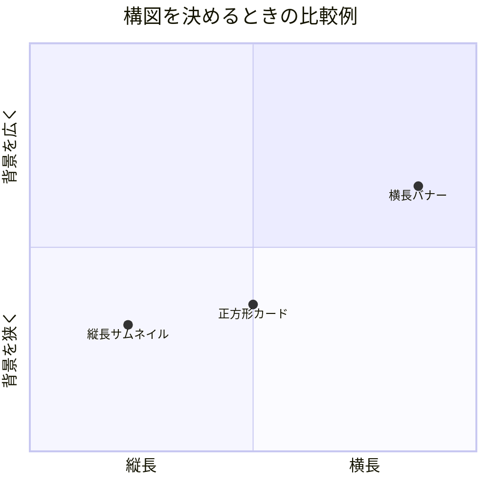

# 写真を用途別の縦横比で切り抜く｜Cropper.js

横長のバナーと正方形のサムネイルでは、同じ写真でも残る範囲が異なります。枠の比率と位置を変えて見比べます。

## 最初に知っておく用語

- **縦横比**は、横幅と高さの比です。
- **クロップ**は、画像の一部を切り出す処理です。

## 象限図で考える

二つの軸で用途ごとの構図を比べます。位置は判断の例です。

## ライブデモ

[公開用ライブデモ](https://papanda925.github.io/Daily-Code-Samples/demos/cropper-aspect-ratio/#live) ／ [実装HTML](../../docs/demos/cropper-aspect-ratio/index.html) ／ [共通JavaScript](../../docs/demos/browser-library-labs/daily.js)

1. 現行のブラウザーでデモを開く。Mermaidの描画や一部のライブラリーに外部通信を使用する。
2. 「実行」を押す。下記の値や画面内の操作欄を試す。

1 と 1.7778 で切り抜く。枠をドラッグして位置も変える。

### 結果の見方

同じ写真でも残る範囲が変わる。

用意した画像では真ん中以外にも文字がある。枠を中央と左端に動かし、同じ比率でも何が残るか見る。

## コードの要点

選択範囲の縦横比を変え、トリミング後の画像を出力する。利用する版のAPIに合わせる。

実装はデモ画面の「実装コード」で確認できます。

## 仕事で使うとき

サムネイルを作るときは、文字や人物が小画面でも欠けないか見る。

## 参考資料

- [Cropper.jsの参照資料](https://github.com/fengyuanchen/cropperjs)
- [Mermaidの図の書き方](https://mermaid.js.org/intro/syntax-reference.html)

本文はAIを利用して作成しました。

## 実行環境と検証

JavaScriptの構文とファイル間の対応を確認した。 Pagesでの各機能の実行とMermaidの描画は検証範囲に含まれていない。

図が表示されない場合は、本文の読み方とMermaidソースを参照する。デモ欄に取得エラーが出る場合は通信条件を確認する。検証用の架空データを使う。
