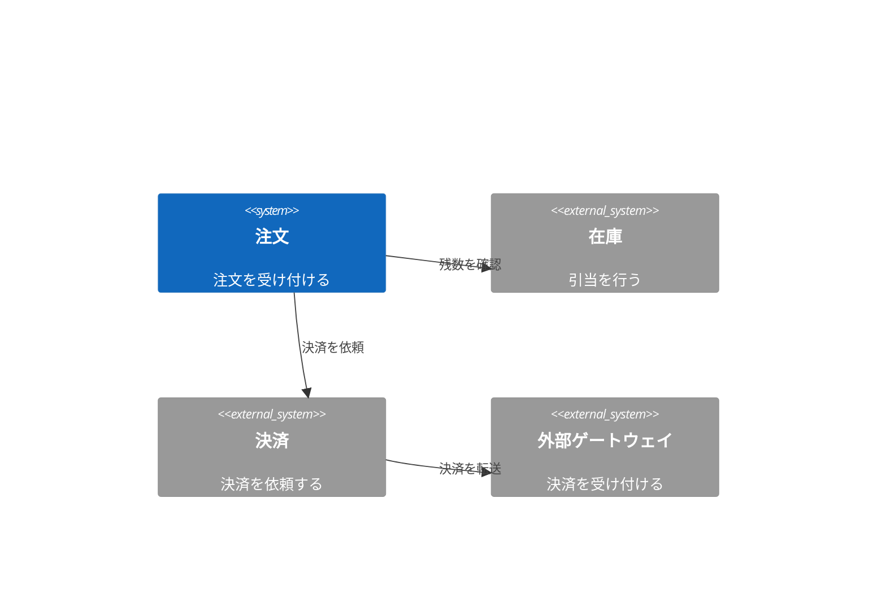

# 障害の影響確認で直接の依存先を探す｜Cytoscape.js

決済機能の不調を調べるとき、注文画面だけを見ても原因を絞れません。機能のつながりを描き、どこまで確認するかを切り替えます。

## 最初に知っておく用語

- **依存先**は、自分の動作に必要な別の機能です。
- **探索範囲**は、何段先までたどるかです。

## C4コンテキスト図で考える

機能の担当範囲とつながりを示します。外部ゲートウェイへは決済を経由します。

## ライブデモ

[公開用ライブデモ](https://papanda925.github.io/Daily-Code-Samples/demos/cytoscape-dependency-impact/#live) ／ [実装HTML](../../docs/demos/cytoscape-dependency-impact/index.html) ／ [共通JavaScript](../../docs/demos/browser-library-labs/daily.js)

1. 現行のブラウザーでデモを開く。Mermaidの描画や一部のライブラリーに外部通信を使用する。
2. 「実行」を押す。下記の値や画面内の操作欄を試す。

1 と 2 を切り替える。色が変わるノードを見る。

### 結果の見方

1段では在庫と決済が対象。2段で外部ゲートウェイに届く。

矢印は依存の方向を示す。影響を受ける側から逆向きに探す場合は、先へ進む探索と区別する。

## コードの要点

注文ノードの outgoers を強調する。

実装はデモ画面の「実装コード」で確認できます。

## 仕事で使うとき

障害影響の調査では、直接の依存先と間接の依存先で確認順を分ける。

## 参考資料

- [Cytoscape.jsの参照資料](https://github.com/cytoscape/cytoscape.js)
- [Mermaidの図の書き方](https://mermaid.js.org/intro/syntax-reference.html)

本文はAIを利用して作成しました。

## 実行環境と検証

JavaScriptの構文とファイル間の対応を確認した。 Pagesでの各機能の実行とMermaidの描画は検証範囲に含まれていない。

図が表示されない場合は、本文の読み方とMermaidソースを参照する。デモ欄に取得エラーが出る場合は通信条件を確認する。検証用の架空データを使う。
