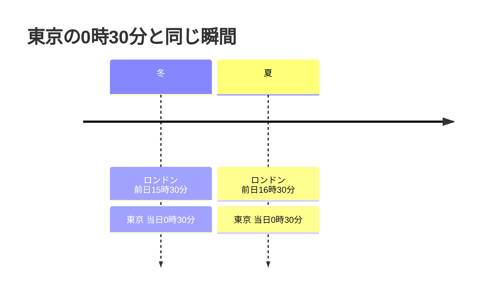

# 深夜の会議を海外拠点の現地時刻に換算する｜Day.js

東京で日付が変わった直後、ロンドンはまだ前日です。夏と冬で何時間ずれるかを比べます。

## 最初に知っておく用語

- **タイムゾーン**は、地域ごとの時刻の規則です。
- **UTCオフセット**は、世界協定時との時差です。

## タイムラインで考える

季節ごとに二つの表示を読みます。同じ日付の組を示すものではありません。

## ライブデモ

[公開用ライブデモ](https://papanda925.github.io/Daily-Code-Samples/demos/dayjs-london-meeting/#live) ／ [実装HTML](../../docs/demos/dayjs-london-meeting/index.html) ／ [共通JavaScript](../../docs/demos/browser-library-labs/daily.js)

1. 現行のブラウザーでデモを開く。Mermaidの描画や一部のライブラリーに外部通信を使用する。
2. 「実行」を押す。下記の値や画面内の操作欄を試す。

冬の東京 00:30 を換算する。日付を 2026-07-15 に変える。

### 結果の見方

ロンドンは冬なら前日15:30。夏は前日16:30。

東京の時刻には日付も含める。現地が前日になる案内は、日付と曜日まで表示すると誤読を減らせる。

## コードの要点

utc と timezone の両プラグインを読み、dayjs.tz で東京として解釈して Europe/London に変換する。

実装はデモ画面の「実装コード」で確認できます。

## 仕事で使うとき

会議案内には都市名と日付を含める。時差を年中固定すると夏にずれる。

## 参考資料

- [Day.jsの参照資料](https://github.com/iamkun/dayjs)
- [Mermaidの図の書き方](https://mermaid.js.org/intro/syntax-reference.html)

本文はAIを利用して作成しました。

## 実行環境と検証

JavaScriptの構文とファイル間の対応を確認した。 Pagesでの各機能の実行とMermaidの描画は検証範囲に含まれていない。

図が表示されない場合は、本文の読み方とMermaidソースを参照する。デモ欄に取得エラーが出る場合は通信条件を確認する。検証用の架空データを使う。
