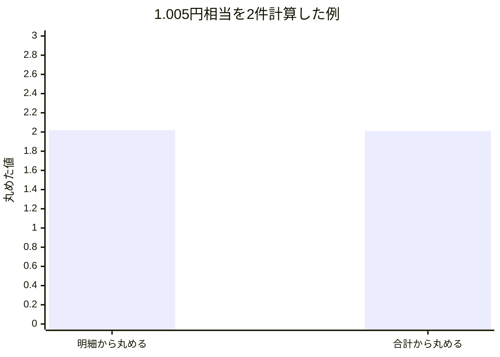

# 明細丸めと合計丸めで請求額が変わる理由｜decimal.js

同じ請求明細でも、丸めるタイミングが違うと合計がずれます。中間の値を二件使い、違いが出る順序を確かめます。

## 最初に知っておく用語

- **丸め**は、桁を決めて数値を近づける処理です。
- **ROUND_HALF_UP**は、中間値を絶対値の大きい側へ寄せる規則です。

## XYチャートで考える

両者の差は0.01です。棒の高さの差が小さいため、数値は実験の出力でも確認します。

## ライブデモ

[公開用ライブデモ](https://papanda925.github.io/Daily-Code-Samples/demos/decimal-invoice-rounding/#live) ／ [実装HTML](../../docs/demos/decimal-invoice-rounding/index.html) ／ [共通JavaScript](../../docs/demos/browser-library-labs/daily.js)

1. 現行のブラウザーでデモを開く。Mermaidの描画や一部のライブラリーに外部通信を使用する。
2. 「実行」を押す。下記の値や画面内の操作欄を試す。

1.005 を2行入れる。1.004 に変えた場合も比べる。

### 結果の見方

1.005 が2行なら行単位で2.02。合計してから丸めると2.01。

1.005を小数第2位へ丸めると1.01になる。先に2行を足すと2.010になる。この順序の違いが結果を分ける。

## コードの要点

文字列から Decimal を作り、各行を丸めて足す方法と、足してから丸める方法を比べる。

実装はデモ画面の「実装コード」で確認できます。

## 仕事で使うとき

丸める単位は請求仕様で先に合意する。テストにちょうど中間の値を入れる。

## 参考資料

- [decimal.jsの参照資料](https://github.com/MikeMcl/decimal.js)
- [Mermaidの図の書き方](https://mermaid.js.org/intro/syntax-reference.html)

本文はAIを利用して作成しました。

## 実行環境と検証

JavaScriptの構文とファイル間の対応を確認した。 Pagesでの各機能の実行とMermaidの描画は検証範囲に含まれていない。

図が表示されない場合は、本文の読み方とMermaidソースを参照する。デモ欄に取得エラーが出る場合は通信条件を確認する。検証用の架空データを使う。
