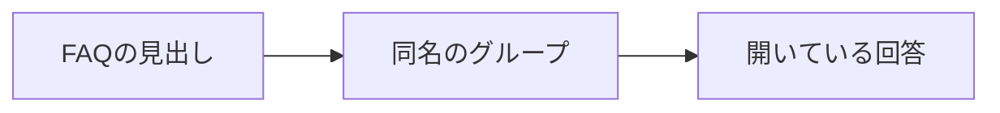

# FAQを一度に一つだけ開く｜details

短いFAQを読むなら、回答が一つずつ開くと現在地が分かりやすくなります。複数を開く設定とも比べます。

## 最初に知っておく用語

- **開閉ウィジェット**は、内容の表示を切り替える部品です。
- **グループ**は、同じ名前でまとめた開閉部品です。

## 処理のフローチャートで考える

左から右に読みます。「同名のグループ」が変わると「開いている回答」にどう影響するかを予想します。

## ライブデモ

[公開用ライブデモ](https://papanda925.github.io/Daily-Code-Samples/demos/details-faq-group/#live) ／ [実装HTML](../../docs/demos/details-faq-group/index.html) ／ [共通JavaScript](../../docs/demos/browser-library-labs/daily.js)

1. 現行のブラウザーでデモを開く。Mermaidの描画や一部のライブラリーに外部通信を使用する。
2. 「実行」を押す。下記の値や画面内の操作欄を試す。

二つの回答を順に開く。設定を「個別」に変えて比べる。

### 結果の見方

グループでは次を開くと前が閉じる。

同じ名前を指定すると部品がまとまる。別のFAQまで同時に閉じてしまう場合は、グループ名を分ける。

## コードの要点

各detailsに同じ name を指定し、順番にsummaryを押す。

実装はデモ画面の「実装コード」で確認できます。

## 仕事で使うとき

回答を見比べる必要があるFAQでは複数を開けるほうが便利な場合もある。

## 参考資料

- [detailsの参照資料](https://developer.mozilla.org/en-US/docs/Web/HTML/Element/details)
- [Mermaidの図の書き方](https://mermaid.js.org/intro/syntax-reference.html)

本文はAIを利用して作成しました。

## 実行環境と検証

JavaScriptの構文とファイル間の対応を確認した。 Pagesでの各機能の実行とMermaidの描画は検証範囲に含まれていない。

図が表示されない場合は、本文の読み方とMermaidソースを参照する。デモ欄に取得エラーが出る場合は通信条件を確認する。検証用の架空データを使う。
