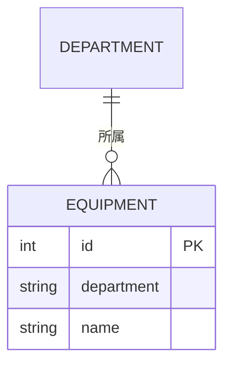

# ブラウザーの備品メモを部署で絞る｜Dexie.js

ブラウザーに置いた備品台帳から、部署に合う行を取り出します。データを保存する機能と、項目を絞り込む機能を一緒に試します。

## 最初に知っておく用語

- **索引**は、指定した項目を探しやすくする仕組みです。
- **IndexedDB**は、ブラウザー内のデータベースです。

## ER図で考える

部署と端末の対応を見る図です。部署に複数の端末が所属できます。Dexieのデモでは端末表に部署名を記録します。

## ライブデモ

[公開用ライブデモ](https://papanda925.github.io/Daily-Code-Samples/demos/dexie-inventory-filter/#live) ／ [実装HTML](../../docs/demos/dexie-inventory-filter/index.html) ／ [共通JavaScript](../../docs/demos/browser-library-labs/daily.js)

1. 現行のブラウザーでデモを開く。Mermaidの描画や一部のライブラリーに外部通信を使用する。
2. 「実行」を押す。下記の値や画面内の操作欄を試す。

総務で検索する。次に経理を入れる。再読み込みして同じ検索を試す。

### 結果の見方

部署に一致する端末が返る。

一覧を全部取り出さず、索引から対象部署を検索できる。このデモの初期データは起動時に同じ内容で書き込む。任意の編集が永続化するかの実験には、初期データの投入を分ける。

## コードの要点

テーブルを '++id,department' で定義し、where('department').equals('総務').toArray() を実行する。

実装はデモ画面の「実装コード」で確認できます。

## 仕事で使うとき

ブラウザーごとに保存先が分かれる。共有台帳にするなら別途データの共有が必要になる。

## 参考資料

- [Dexie.jsの参照資料](https://github.com/dexie/Dexie.js)
- [Mermaidの図の書き方](https://mermaid.js.org/intro/syntax-reference.html)

本文はAIを利用して作成しました。

## 実行環境と検証

JavaScriptの構文とファイル間の対応を確認した。 Pagesでの各機能の実行とMermaidの描画は検証範囲に含まれていない。

図が表示されない場合は、本文の読み方とMermaidソースを参照する。デモ欄に取得エラーが出る場合は通信条件を確認する。検証用の架空データを使う。
