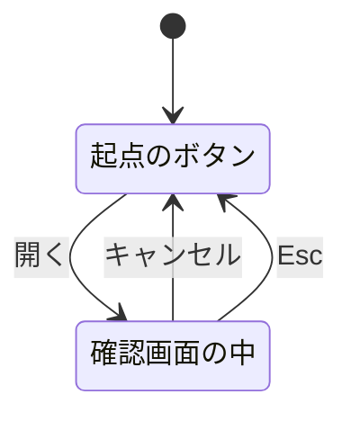

# 確認画面を閉じた後のフォーカスを追う｜dialog

確認画面を閉じた後に入力位置を見失うと、キーボード操作が続けにくくなります。Escやキャンセルの後に焦点がどこへ戻るか調べます。

## 最初に知っておく用語

- **モーダル**は、開いている間は背後を操作できない画面です。
- **フォーカス**は、キー入力を受け取る要素です。

## 状態遷移図で考える

矢印はフォーカスが移るきっかけです。閉じ方が違っても、起点へ戻るかを見ます。

## ライブデモ

[公開用ライブデモ](https://papanda925.github.io/Daily-Code-Samples/demos/dialog-focus-return/#live) ／ [実装HTML](../../docs/demos/dialog-focus-return/index.html) ／ [共通JavaScript](../../docs/demos/browser-library-labs/daily.js)

1. 現行のブラウザーでデモを開く。Mermaidの描画や一部のライブラリーに外部通信を使用する。
2. 「実行」を押す。下記の値や画面内の操作欄を試す。

確認画面を開く。TabとEscを押す。

### 結果の見方

閉じると起点のボタンに戻ることを確認できる。

確認画面を開いた直後に Tab を押す。どのボタンへ移るかを確認する。Escで閉じた場合も、クリックした場合と同じ起点を確認する。

## コードの要点

showModal() で表示し、キャンセル後に document.activeElement を読む。

実装はデモ画面の「実装コード」で確認できます。

## 仕事で使うとき

フォーム内ではキャンセルでデータが消えないかも確認する。

## 参考資料

- [dialogの参照資料](https://developer.mozilla.org/en-US/docs/Web/HTML/Element/dialog)
- [Mermaidの図の書き方](https://mermaid.js.org/intro/syntax-reference.html)

本文はAIを利用して作成しました。

## 実行環境と検証

JavaScriptの構文とファイル間の対応を確認した。 Pagesでの各機能の実行とMermaidの描画は検証範囲に含まれていない。

図が表示されない場合は、本文の読み方とMermaidソースを参照する。デモ欄に取得エラーが出る場合は通信条件を確認する。検証用の架空データを使う。
