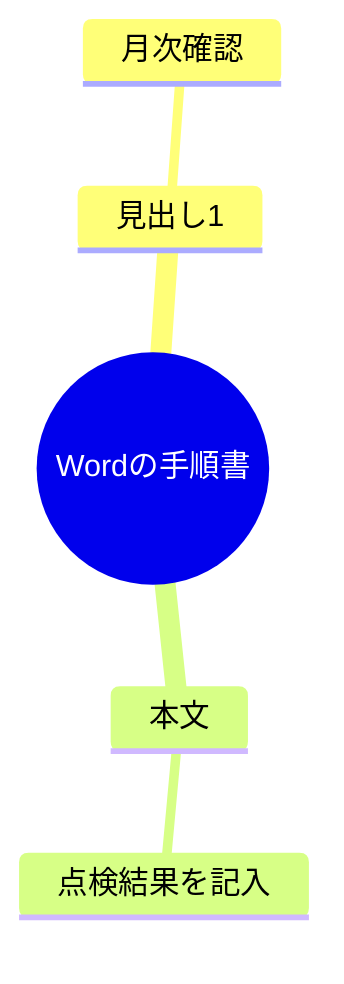

# 手順書の構成をWordファイルに書き出す｜docx

手順書のファイルを自動生成する例です。見出しに専用のスタイルを割り当て、Wordの見出し一覧で探せる形にします。

## 最初に知っておく用語

- **段落スタイル**は、見出しや本文の種類を表す設定です。
- **DOCX**は、Wordで使う文書形式です。

## マインドマップで考える

文書を組み立てる要素を中心から分けて示します。見出しには見出し用の書式を割り当てます。

## ライブデモ

[公開用ライブデモ](https://papanda925.github.io/Daily-Code-Samples/demos/docx-heading-styles/#live) ／ [実装HTML](../../docs/demos/docx-heading-styles/index.html) ／ [共通JavaScript](../../docs/demos/browser-library-labs/daily.js)

1. 現行のブラウザーでデモを開く。Mermaidの描画や一部のライブラリーに外部通信を使用する。
2. 「実行」を押す。下記の値や画面内の操作欄を試す。

ダミー見出しを変えて生成する。Wordのナビゲーションで確認する。

### 結果の見方

見出しスタイルを割り当てた行が見出しとして扱われる。

太字と見出しスタイルは文書内で別の役割を持つ。Wordの見出し一覧で見えるかを比べると、スタイルの効果を確認できる。

## コードの要点

Document に見出し段落と行を入れ、ブラウザーなら Packer.toBlob で取得する。

実装はデモ画面の「実装コード」で確認できます。

## 仕事で使うとき

提出用Word文書は指定された提出版を直接ひな形に使う。ここでは仕組みの説明用にサンプルを生成する。

## 参考資料

- [docxの参照資料](https://github.com/dolanmiu/docx)
- [Mermaidの図の書き方](https://mermaid.js.org/intro/syntax-reference.html)

本文はAIを利用して作成しました。

## 実行環境と検証

JavaScriptの構文とファイル間の対応を確認した。 Pagesでの各機能の実行とMermaidの描画は検証範囲に含まれていない。

図が表示されない場合は、本文の読み方とMermaidソースを参照する。デモ欄に取得エラーが出る場合は通信条件を確認する。検証用の架空データを使う。
