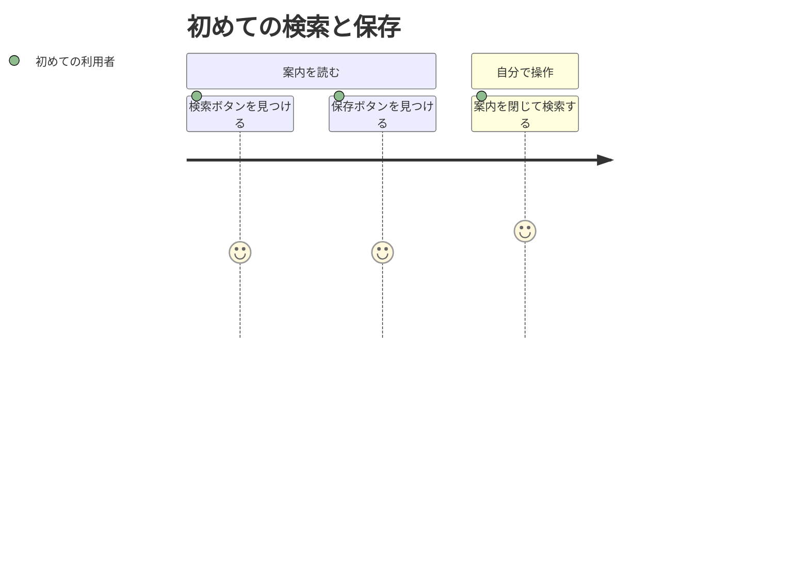

# 初めて使う画面の操作手順を順番に示す｜Driver.js

初めて使う画面では、ボタンの場所が分かるだけでも迷いが減ります。検索と保存を順番に案内し、途中で閉じたときの動作を見ます。

## 最初に知っておく用語

- **ツアー**は、操作箇所を順に示す案内です。
- **ステップ**は、案内の1段階です。

## ユーザージャーニー図で考える

利用者がたどる段階を示します。1〜5の点数は操作の分かりやすさを想定した例です。

## ライブデモ

[公開用ライブデモ](https://papanda925.github.io/Daily-Code-Samples/demos/driverjs-guided-tour/#live) ／ [実装HTML](../../docs/demos/driverjs-guided-tour/index.html) ／ [共通JavaScript](../../docs/demos/browser-library-labs/daily.js)

1. 現行のブラウザーでデモを開く。Mermaidの描画や一部のライブラリーに外部通信を使用する。
2. 「実行」を押す。下記の値や画面内の操作欄を試す。

案内を開始する。途中で閉じて画面のボタンを押す。

### 結果の見方

操作の順番を確認できる。閉じてもボタンは使える。

ガイドが示すボタン名と実際の画面をそろえる。終了後に元の操作に戻れるか、マウスだけでなくキーでも試す。

## コードの要点

各ボタンを対象とする steps を作り、ガイドを起動する。

実装はデモ画面の「実装コード」で確認できます。

## 仕事で使うとき

ガイドを毎回開くと慣れた利用者の邪魔になる。任意に呼び出せるようにする。

## 参考資料

- [Driver.jsの参照資料](https://github.com/kamranahmedse/driver.js)
- [Mermaidの図の書き方](https://mermaid.js.org/intro/syntax-reference.html)

本文はAIを利用して作成しました。

## 実行環境と検証

JavaScriptの構文とファイル間の対応を確認した。 Pagesでの各機能の実行とMermaidの描画は検証範囲に含まれていない。

図が表示されない場合は、本文の読み方とMermaidソースを参照する。デモ欄に取得エラーが出る場合は通信条件を確認する。検証用の架空データを使う。
