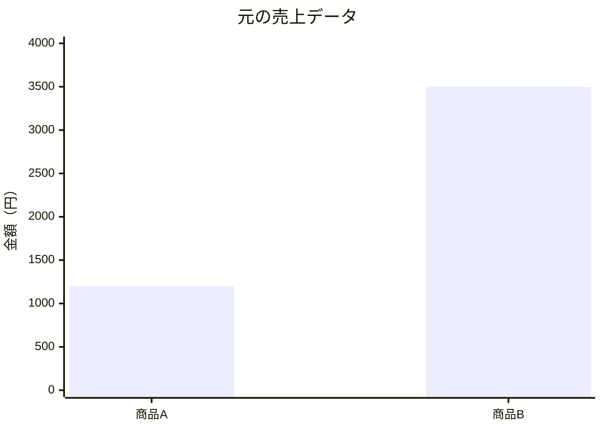

# 売上表をExcelで開ける形にする｜ExcelJS

売上ファイルは、金額がきれいに見えても集計できるとは限りません。ExcelJSで、売上の表示とセルの値を別々に確かめます。

## 最初に知っておく用語

- **表示形式**は、値の見せ方を決める設定です。
- **ワークブック**は、Excelファイル全体です。

## XYチャートで考える

棒の高さは売上額です。両方を数値として保存すると合計は4,700円です。



## ライブデモ

[公開用ライブデモ](https://papanda925.github.io/Daily-Code-Samples/demos/exceljs-sales-workbook/#live) ／ [実装HTML](../../docs/demos/exceljs-sales-workbook/index.html) ／ [共通JavaScript](../../docs/demos/browser-library-labs/daily.js)

1. 現行のブラウザーでデモを開く。Mermaidの描画や一部のライブラリーに外部通信を使用する。
2. 「実行」を押す。下記の値や画面内の操作欄を試す。

商品Aの金額を変えて保存する。1200 と 1200円 を別々に試す。

### 結果の見方

数値なら 1,200 と表示できる。文字列は Excel の SUM で集計から外れる場合がある。

通貨記号を付けたい場合は型を数値に保つ。金額の記号はセルの表示形式で指定できる。実ファイルでは合計セルの数式も点検する。

## コードの要点

金額列の numFmt を '#,##0' にして workbook.xlsx.writeBuffer() で生成する。

実装はデモ画面の「実装コード」で確認できます。

## 数式の計算結果について

このデモの合計セルは `{formula:'SUM(B2:B3)', result: ...}` を書き込みます。**ExcelJSは数式を評価して結果を計算するライブラリーではありません**。デモ側が入力の型から `result` を計算して、数式と一緒に保存します。画面に出る「合計」も、この教材で設定した値です。

`SUM(B2:B3)` のようにセル範囲を参照する式では、文字列として保存されたセルは数値と同じ扱いにならず、合計から除外されます。ExcelJSに数式を書かせただけで、計算結果の正しさまで保証されたとは考えないでください。実際に使うときは、入力の検証、数式、結果の3点を対象のExcel環境で確認します。このデモはExcelやExcel for the webでの再計算・表示を検証していません。

`numFmt = '#,##0'` は数値の見え方を変える表示形式で、値を文字列から数値へ変換する設定ではありません。カンマ区切りの `1,200` や通貨記号付きの `1200円` は、このデモの入力変換では数値にならず、文字列として扱われます。

## 検査

リポジトリのルートで次を実行します。

```sh
node --check docs/demos/browser-library-labs/daily.js
node web/exceljs-sales-workbook/verify-demo.cjs
```

`verify-demo.cjs` はHTMLと共通JavaScriptの対応、入力の数値・文字列判定、デモが設定する合計値を検査します。ExcelJSを読み込んだブラウザーでのXLSX生成や、Excelで開いた後の再計算を確認するテストではありません。Pages画面の操作確認も別途必要です。

## 仕事で使うとき

通貨と数値の型を先に決める。CSVとExcelでは表示形式の扱いも違う。

## 参考資料

- [ExcelJSの参照資料](https://github.com/exceljs/exceljs)
- [Mermaidの図の書き方](https://mermaid.js.org/intro/syntax-reference.html)

本文はAIを利用して作成しました。

## 実行環境と検証

JavaScriptの構文とファイル間の対応を確認した。 Pagesでの各機能の実行とMermaidの描画は検証範囲に含まれていない。

図が表示されない場合は、本文の読み方とMermaidソースを参照する。デモ欄に取得エラーが出る場合は通信条件を確認する。検証用の架空データを使う。
