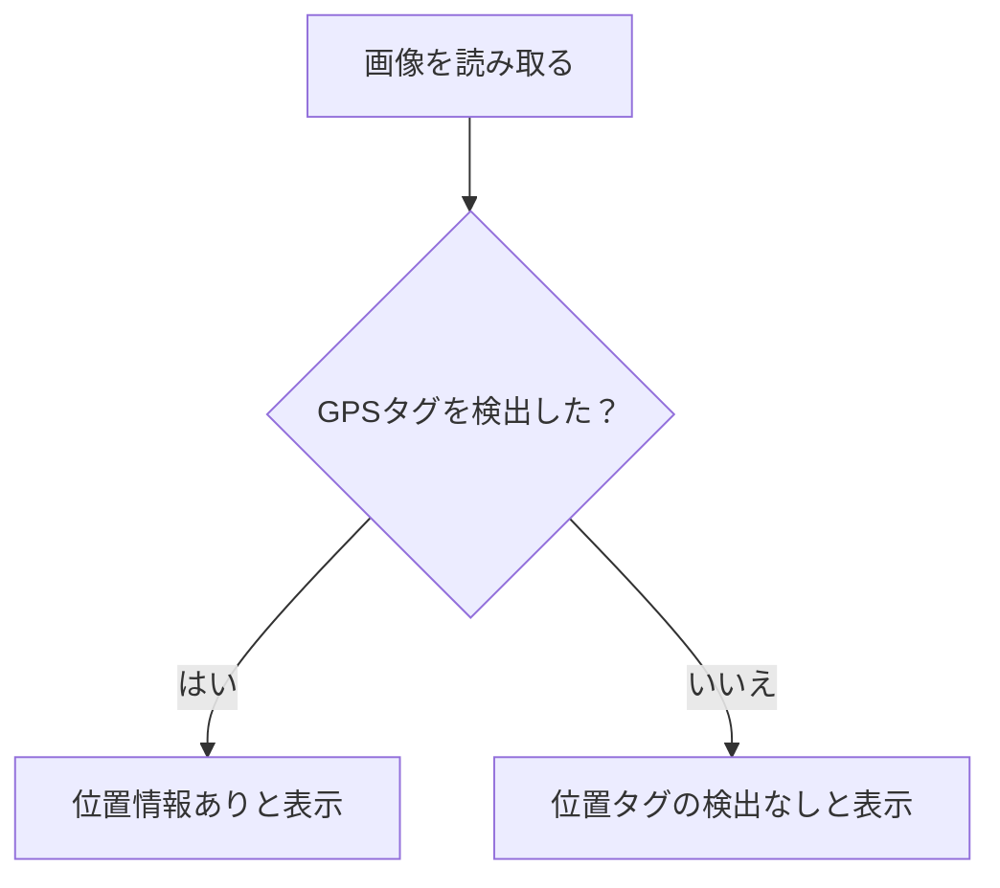

# 共有写真に位置情報があるか確認する｜ExifReader

写真によっては、見た目から分からない撮影位置が記録されています。テスト画像を使い、GPS関連のタグがあるか調べます。

## 最初に知っておく用語

- **Exif**は、写真に付随する撮影情報です。
- **GPSタグ**は、位置に関する付加情報です。

## 分岐のフローチャートで考える

ひし形で「GPSタグを検出した」を確認します。結果によって次に進む先が変わります。

## ライブデモ

[公開用ライブデモ](https://papanda925.github.io/Daily-Code-Samples/demos/exif-gps-check/#live) ／ [実装HTML](../../docs/demos/exif-gps-check/index.html) ／ [共通JavaScript](../../docs/demos/browser-library-labs/daily.js)

1. 現行のブラウザーでデモを開く。Mermaidの描画や一部のライブラリーに外部通信を使用する。
2. 「実行」を押す。下記の値や画面内の操作欄を試す。

テスト写真を選ぶ。GPSを記録しない写真でも試す。

### 結果の見方

GPS関連タグがあれば警告が出る。

このデモは値そのものを表示しない。自分で用意した検証用の画像を使い、公開予定の写真は位置以外の写り込みも別に確認する。

## コードの要点

ExifReader.load の結果からGPS関連タグの有無だけを表示する。

実装はデモ画面の「実装コード」で確認できます。

## 仕事で使うとき

タグの表示がない場合でも、写り込みや別形式の位置情報を確認する。

## 参考資料

- [ExifReaderの参照資料](https://github.com/mattiasw/ExifReader)
- [Mermaidの図の書き方](https://mermaid.js.org/intro/syntax-reference.html)

本文はAIを利用して作成しました。

## 実行環境と検証

JavaScriptの構文とファイル間の対応を確認した。 Pagesでの各機能の実行とMermaidの描画は検証範囲に含まれていない。

図が表示されない場合は、本文の読み方とMermaidソースを参照する。デモ欄に取得エラーが出る場合は通信条件を確認する。検証用の架空データを使う。
