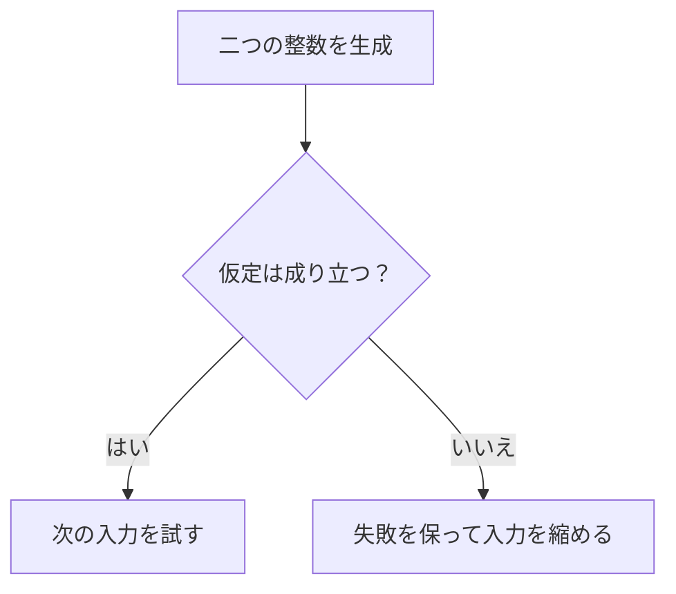

# 失敗するテスト入力を最小化する｜fast-check

足し算をすると値が増えると思うと、負の入力を見落とします。実験で失敗する入力を探し、どの値が仮定を崩したかを調べます。

## 最初に知っておく用語

- **反例**は、仮定が成り立たない入力です。
- **縮小**は、失敗を保ったまま入力を小さくする処理です。

## 分岐のフローチャートで考える

ひし形で「仮定は成り立つ」を確認します。結果によって次に進む先が変わります。

## ライブデモ

[公開用ライブデモ](https://papanda925.github.io/Daily-Code-Samples/demos/fast-check-counterexample/#live) ／ [実装HTML](../../docs/demos/fast-check-counterexample/index.html) ／ [共通JavaScript](../../docs/demos/browser-library-labs/daily.js)

1. 現行のブラウザーでデモを開く。Mermaidの描画や一部のライブラリーに外部通信を使用する。
2. 「実行」を押す。下記の値や画面内の操作欄を試す。

シード42で試す。43に変えて反例を見る。

### 結果の見方

負の b を含む小さな反例が得られる。

例で調べる仮定は a+b が a 以上というもの。b の符号に注目すると、失敗した理由を短く説明できる。

## コードの要点

整数の生成器を二つ用意し、fc.property で仮定を検査する。

実装はデモ画面の「実装コード」で確認できます。

## 仕事で使うとき

失敗報告にはシードとパスを残す。後から同じ反例を再現しやすい。

## 参考資料

- [fast-checkの参照資料](https://github.com/dubzzz/fast-check)
- [Mermaidの図の書き方](https://mermaid.js.org/intro/syntax-reference.html)

本文はAIを利用して作成しました。

## 実行環境と検証

JavaScriptの構文とファイル間の対応を確認した。 Pagesでの各機能の実行とMermaidの描画は検証範囲に含まれていない。

図が表示されない場合は、本文の読み方とMermaidソースを参照する。デモ欄に取得エラーが出る場合は通信条件を確認する。検証用の架空データを使う。
