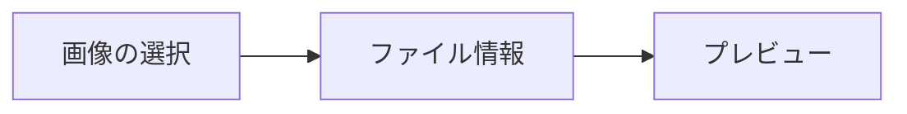

# 選んだ画像のサイズを送信前に見る｜File API

画像を送る前に、利用者へ容量と見た目を知らせると選び直しやすくなります。ブラウザーでファイルを選び、画像と容量を確認します。

## 最初に知っておく用語

- **File**は、ブラウザーが扱うファイル情報です。
- **オブジェクトURL**は、手元のデータを表示するため一時的に発行したURLです。

## 処理のフローチャートで考える

左から右に読みます。「ファイル情報」が変わると「プレビュー」にどう影響するかを予想します。

## ライブデモ

[公開用ライブデモ](https://papanda925.github.io/Daily-Code-Samples/demos/file-image-preview/#live) ／ [実装HTML](../../docs/demos/file-image-preview/index.html) ／ [共通JavaScript](../../docs/demos/browser-library-labs/daily.js)

1. 現行のブラウザーでデモを開く。Mermaidの描画や一部のライブラリーに外部通信を使用する。
2. 「実行」を押す。下記の値や画面内の操作欄を試す。

別々のダミー画像を選ぶ。バイト数と表示を比べる。

### 結果の見方

選び直すと名前と容量と画像が切り替わる。

容量と画像の縦横の大きさは別の情報だ。送信制限に使うならバイト数を確認する。画素数の制限は画像の読み取り後に測る。

## コードの要点

input.files の最初の File から size と name を読み、必要ならオブジェクトURLでプレビューする。

実装はデモ画面の「実装コード」で確認できます。

## 仕事で使うとき

数値の単位を明記する。入力制限は送信先でも検証する。

## 参考資料

- [File APIの参照資料](https://developer.mozilla.org/en-US/docs/Web/API/File_API)
- [Mermaidの図の書き方](https://mermaid.js.org/intro/syntax-reference.html)

本文はAIを利用して作成しました。

## 実行環境と検証

JavaScriptの構文とファイル間の対応を確認した。 Pagesでの各機能の実行とMermaidの描画は検証範囲に含まれていない。

図が表示されない場合は、本文の読み方とMermaidソースを参照する。デモ欄に取得エラーが出る場合は通信条件を確認する。検証用の架空データを使う。
