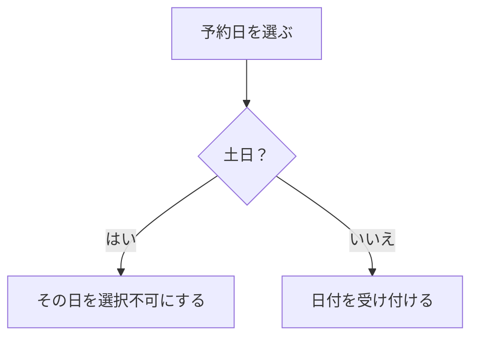

# 休業日を予約の候補から外す｜flatpickr

窓口が土日に休むなら、予約フォームで土日を候補から外せます。金曜と土曜を順に選び、入力欄の違いを確認します。

## 最初に知っておく用語

- **日付ピッカー**は、カレンダーから日付を選ぶ入力部品です。
- **無効日**は、選択できない日です。

## 分岐のフローチャートで考える

ひし形で「土日」を確認します。結果によって次に進む先が変わります。

## ライブデモ

[公開用ライブデモ](https://papanda925.github.io/Daily-Code-Samples/demos/flatpickr-closed-days/#live) ／ [実装HTML](../../docs/demos/flatpickr-closed-days/index.html) ／ [共通JavaScript](../../docs/demos/browser-library-labs/daily.js)

1. 現行のブラウザーでデモを開く。Mermaidの描画や一部のライブラリーに外部通信を使用する。
2. 「実行」を押す。下記の値や画面内の操作欄を試す。

カレンダーで金曜と土曜を押す。入力欄が更新される日を確認する。

### 結果の見方

土日は選べない。

休日の範囲は地域や運用で違う。土日だけで決められない場合は、祝日や臨時休業日も受付の条件へ追加する。

## コードの要点

disable に土日を返す関数を指定する。

実装はデモ画面の「実装コード」で確認できます。

## 仕事で使うとき

予約受付側でも休業日を検証する。クライアントのカレンダーは入力を助ける役割を持つ。

## 参考資料

- [flatpickrの参照資料](https://github.com/flatpickr/flatpickr)
- [Mermaidの図の書き方](https://mermaid.js.org/intro/syntax-reference.html)

本文はAIを利用して作成しました。

## 実行環境と検証

JavaScriptの構文とファイル間の対応を確認した。 Pagesでの各機能の実行とMermaidの描画は検証範囲に含まれていない。

図が表示されない場合は、本文の読み方とMermaidソースを参照する。デモ欄に取得エラーが出る場合は通信条件を確認する。検証用の架空データを使う。
