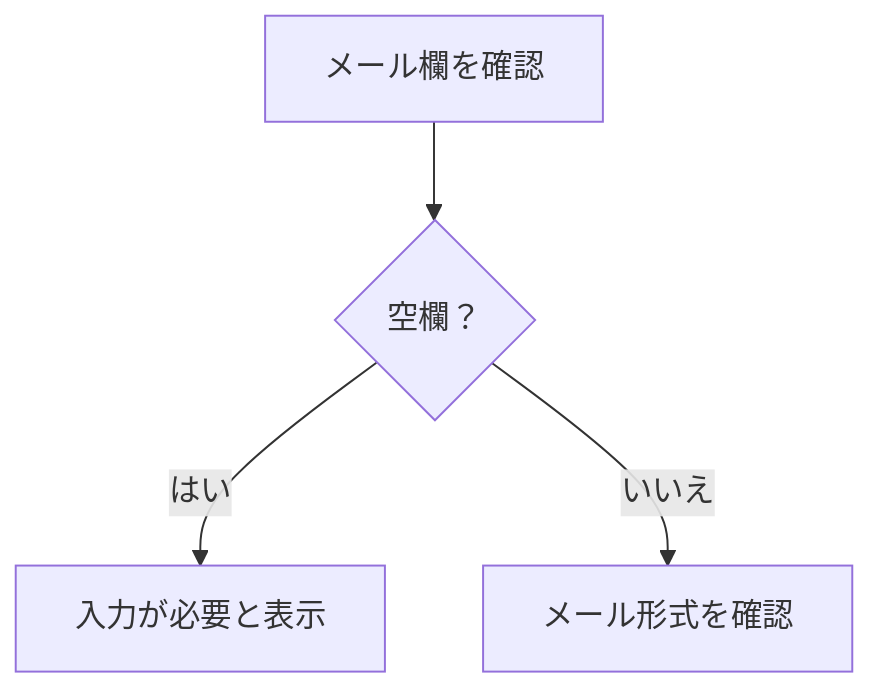

# 空欄と形式違いを一つずつ検出する｜フォーム制約検証

メールアドレス欄が空の場合と、書式が違う場合では、直す箇所が違います。ブラウザーから理由を二つに分けて取得します。

## 最初に知っておく用語

- **制約検証**は、入力が条件を満たすかを確かめる機能です。
- **形式違い**は、入力済みの値が要求された形と異なる状態です。

## 分岐のフローチャートで考える

ひし形で「空欄」を確認します。結果によって次に進む先が変わります。

## ライブデモ

[公開用ライブデモ](https://papanda925.github.io/Daily-Code-Samples/demos/form-validity-email/#live) ／ [実装HTML](../../docs/demos/form-validity-email/index.html) ／ [共通JavaScript](../../docs/demos/browser-library-labs/daily.js)

1. 現行のブラウザーでデモを開く。Mermaidの描画や一部のライブラリーに外部通信を使用する。
2. 「実行」を押す。下記の値や画面内の操作欄を試す。

空欄と abc と demo@example.test を試す。

### 結果の見方

空欄と形式違いが別々の理由として出る。

ブラウザーは形式を見て判断する。受信先のアドレスが実際に存在するかは、この検証からは分からない。

## コードの要点

type=email と required を指定して validity の valueMissing と typeMismatch を見る。

実装はデモ画面の「実装コード」で確認できます。

## 仕事で使うとき

画面で検証していても、受信する側で同じ前提を確認する。

## 参考資料

- [フォーム制約検証の参照資料](https://developer.mozilla.org/en-US/docs/Web/HTML/Guides/Constraint_validation)
- [Mermaidの図の書き方](https://mermaid.js.org/intro/syntax-reference.html)

本文はAIを利用して作成しました。

## 実行環境と検証

JavaScriptの構文とファイル間の対応を確認した。 Pagesでの各機能の実行とMermaidの描画は検証範囲に含まれていない。

図が表示されない場合は、本文の読み方とMermaidソースを参照する。デモ欄に取得エラーが出る場合は通信条件を確認する。検証用の架空データを使う。
