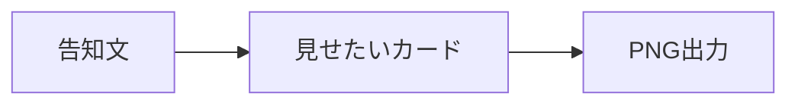

# 告知カードをPNGにして共有する｜html-to-image

告知カードをSNSやチャットへ添えるには、画像として取り出せると便利です。画面のカード部分だけをPNGに変換します。

## 最初に知っておく用語

- **DOM**は、ページの要素を操作するための仕組みです。
- **PNG**は、画像の保存形式です。

## 処理のフローチャートで考える

左から右に読みます。「見せたいカード」が変わると「PNG出力」にどう影響するかを予想します。

## ライブデモ

[公開用ライブデモ](https://papanda925.github.io/Daily-Code-Samples/demos/html-to-image-notice/#live) ／ [実装HTML](../../docs/demos/html-to-image-notice/index.html) ／ [共通JavaScript](../../docs/demos/browser-library-labs/daily.js)

1. 現行のブラウザーでデモを開く。Mermaidの描画や一部のライブラリーに外部通信を使用する。
2. 「実行」を押す。下記の値や画面内の操作欄を試す。

告知文を変える。出力画像に操作欄が写るか確認する。

### 結果の見方

カードだけが画像になる。

出力の対象を親の画面全体に広げると、操作ボタンまで入る。出力したい範囲を独立した要素にしておく。

## コードの要点

toPng の対象をカードだけに限定し、結果を画像として表示する。

実装はデモ画面の「実装コード」で確認できます。

## 仕事で使うとき

素材の配信元が混ざると画像化に失敗することがある。画像の取得条件を先にそろえる。

## 参考資料

- [html-to-imageの参照資料](https://github.com/bubkoo/html-to-image)
- [Mermaidの図の書き方](https://mermaid.js.org/intro/syntax-reference.html)

本文はAIを利用して作成しました。

## 実行環境と検証

JavaScriptの構文とファイル間の対応を確認した。 Pagesでの各機能の実行とMermaidの描画は検証範囲に含まれていない。

図が表示されない場合は、本文の読み方とMermaidソースを参照する。デモ欄に取得エラーが出る場合は通信条件を確認する。検証用の架空データを使う。
