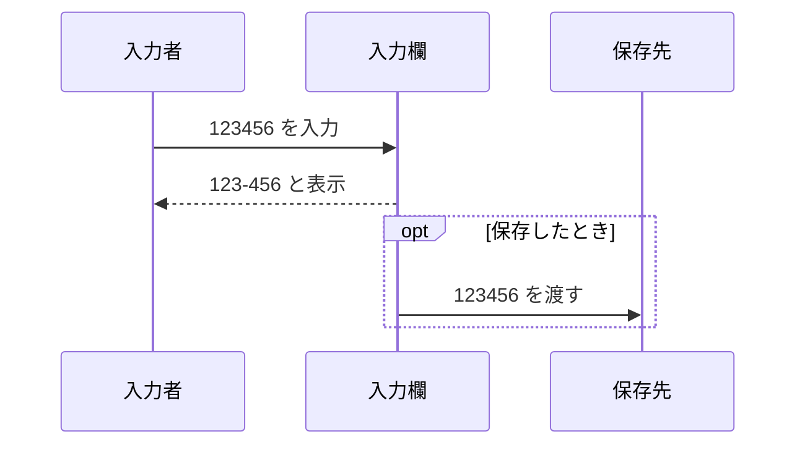

# 伝票番号の画面表示と保存値を分ける｜IMask

伝票番号に区切りがあると読みやすくなります。入力欄にハイフンを表示しながら、保存には数字の並びを使います。

## 最初に知っておく用語

- **入力マスク**は、入力中に形式をそろえるルールです。
- **保存値**は、システムに渡す値です。

## シーケンス図で考える

上から下に読みます。入力欄の見せ方と保存用の値を別の矢印で示します。

## ライブデモ

[公開用ライブデモ](https://papanda925.github.io/Daily-Code-Samples/demos/imask-record-number/#live) ／ [実装HTML](../../docs/demos/imask-record-number/index.html) ／ [共通JavaScript](../../docs/demos/browser-library-labs/daily.js)

1. 現行のブラウザーでデモを開く。Mermaidの描画や一部のライブラリーに外部通信を使用する。
2. 「実行」を押す。下記の値や画面内の操作欄を試す。

123456 と入力する。文字や短い番号も試す。

### 結果の見方

表示は 123-456。保存値は 123456。

先頭が0の番号も試す。識別番号を数値へ変換すると先頭の0が落ちるため、保存値は用途に合う型にする。

## コードの要点

000-000 のマスクを指定して value と unmaskedValue を表示する。

実装はデモ画面の「実装コード」で確認できます。

## 仕事で使うとき

表示を整えても所定の桁数かは別途検証する。

## 参考資料

- [IMaskの参照資料](https://github.com/uNmAnNeR/imaskjs)
- [Mermaidの図の書き方](https://mermaid.js.org/intro/syntax-reference.html)

本文はAIを利用して作成しました。

## 実行環境と検証

JavaScriptの構文とファイル間の対応を確認した。 Pagesでの各機能の実行とMermaidの描画は検証範囲に含まれていない。

図が表示されない場合は、本文の読み方とMermaidソースを参照する。デモ欄に取得エラーが出る場合は通信条件を確認する。検証用の架空データを使う。
