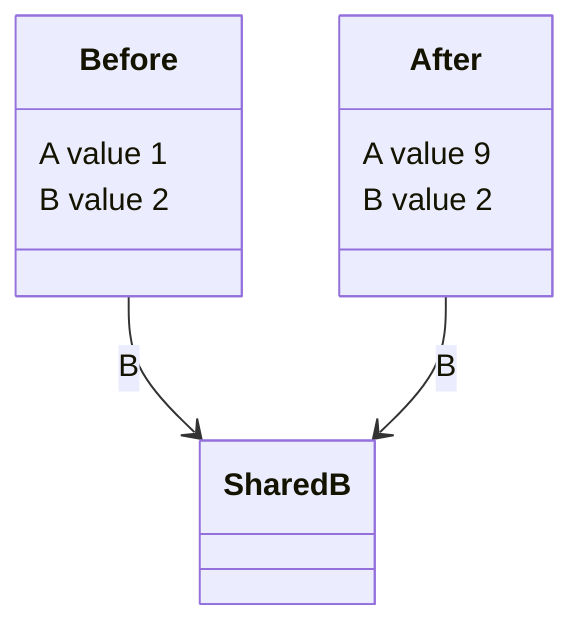

# 入れ子の一項目だけ更新して元データを残す｜Immer

フォームの設定を一つ変えるときは、前回の値を戻せると便利です。Immerで入れ子の一箇所だけを変え、変更しなかった部分も確かめます。

## 最初に知っておく用語

- **イミュータブル**は、既存の値を直接書き換えず扱う考え方です。
- **参照**は、同じオブジェクトを指す情報です。

## クラス図で考える

箱は更新前と更新後のデータ構造です。Bを指す矢印が、同じオブジェクトに集まります。

## ライブデモ

[公開用ライブデモ](https://papanda925.github.io/Daily-Code-Samples/demos/immer-nested-update/#live) ／ [実装HTML](../../docs/demos/immer-nested-update/index.html) ／ [共通JavaScript](../../docs/demos/browser-library-labs/daily.js)

1. 現行のブラウザーでデモを開く。Mermaidの描画や一部のライブラリーに外部通信を使用する。
2. 「実行」を押す。下記の値や画面内の操作欄を試す。

Aの値を 9 にする。元の値とBの一致を確認する。

### 結果の見方

元のAは1のまま。Bは同じオブジェクトを共有する。

更新していないBを共有すると、コピーする範囲を抑えられる。Bを別の処理から書き換える設計は避ける。

## コードの要点

produce 内で draft のAを更新し、元の値と更新後の値を表示する。

実装はデモ画面の「実装コード」で確認できます。

## 仕事で使うとき

画面状態の差分を追うときは、更新前後を別々に残す。

## 参考資料

- [Immerの参照資料](https://github.com/immerjs/immer)
- [Mermaidの図の書き方](https://mermaid.js.org/intro/syntax-reference.html)

本文はAIを利用して作成しました。

## 実行環境と検証

JavaScriptの構文とファイル間の対応を確認した。 Pagesでの各機能の実行とMermaidの描画は検証範囲に含まれていない。

図が表示されない場合は、本文の読み方とMermaidソースを参照する。デモ欄に取得エラーが出る場合は通信条件を確認する。検証用の架空データを使う。
