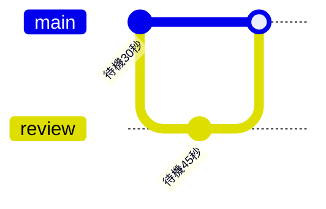

# 手順書の変更点を行と文字で見分ける｜jsdiff

手順書を更新すると、元の版との差を共有したくなります。待ち時間が30秒から45秒に変わった例で、行全体と数字の差を追います。

## 最初に知っておく用語

- **差分**は、二つの版で変わった部分です。
- **粒度**は、比較に使う単位の細かさです。

## Gitグラフで考える

手順書を別の枝で修正し、元の枝へ取り込む例です。差分を見る起点は「待機30秒」です。

## ライブデモ

[公開用ライブデモ](https://papanda925.github.io/Daily-Code-Samples/demos/jsdiff-procedure-changes/#live) ／ [実装HTML](../../docs/demos/jsdiff-procedure-changes/index.html) ／ [共通JavaScript](../../docs/demos/browser-library-labs/daily.js)

1. 現行のブラウザーでデモを開く。Mermaidの描画や一部のライブラリーに外部通信を使用する。
2. 「実行」を押す。下記の値や画面内の操作欄を試す。

区切り線の後の 45 を 60 に変える。行と文字の出力を見る。

### 結果の見方

行差分は変更の場所を示す。文字差分では数字まで追える。

行が丸ごと強調されたら、次に文字で比べる。全角と半角の空白も差になるため、意味のある修正かは文脈を読む。

## コードの要点

diffLines と diffChars の結果を比較し、added と removed を色で分ける。

実装はデモ画面の「実装コード」で確認できます。

## 仕事で使うとき

手順書の更新では行から先に見る。締切などの値は文字差分で確認する。

## 参考資料

- [jsdiffの参照資料](https://github.com/kpdecker/jsdiff)
- [Mermaidの図の書き方](https://mermaid.js.org/intro/syntax-reference.html)

本文はAIを利用して作成しました。

## 実行環境と検証

Node.jsで実行処理を確認した。 Pagesでの各機能の実行とMermaidの描画は検証範囲に含まれていない。

図が表示されない場合は、本文の読み方とMermaidソースを参照する。デモ欄に取得エラーが出る場合は通信条件を確認する。検証用の架空データを使う。
