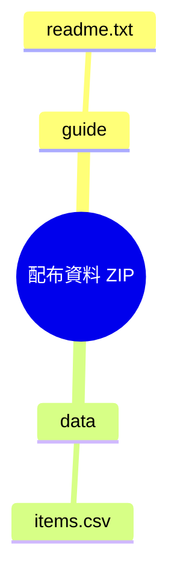

# 配布資料をフォルダー付きZIPにまとめる｜JSZip

資料を一つのZIPにすると渡しやすくなります。手順書とデータを別のフォルダーに入れて、受け取った人が迷わない構成にします。

## 最初に知っておく用語

- **ZIP**は、複数のファイルをまとめられる形式です。
- **相対パス**は、基準の位置から見たファイルの場所です。

## マインドマップで考える

中心から外へ読みます。ZIPの中で、資料がどのフォルダーに入るかを示します。

## ライブデモ

[公開用ライブデモ](https://papanda925.github.io/Daily-Code-Samples/demos/jszip-folder-archive/#live) ／ [実装HTML](../../docs/demos/jszip-folder-archive/index.html) ／ [共通JavaScript](../../docs/demos/browser-library-labs/daily.js)

1. 現行のブラウザーでデモを開く。Mermaidの描画や一部のライブラリーに外部通信を使用する。
2. 「実行」を押す。下記の値や画面内の操作欄を試す。

名前を guide/readme.txt にして保存する。guide を help に変える。

### 結果の見方

ZIPを開くと指定したフォルダーが見える。

ファイル名だけをキーにすると、別フォルダーの同名資料を見落とす。解凍した構造が配布先の案内と合うか確認する。

## コードの要点

zip.file('guide/readme.txt', '使い方') と zip.file('data/items.csv', 'id,name') を実行し、generateAsync でZIPを作る。

実装はデモ画面の「実装コード」で確認できます。

## 仕事で使うとき

同名ファイルを区別するときはフォルダー名も渡す。

## 参考資料

- [JSZipの参照資料](https://github.com/Stuk/jszip)
- [Mermaidの図の書き方](https://mermaid.js.org/intro/syntax-reference.html)

本文はAIを利用して作成しました。

## 実行環境と検証

Node.jsで実行処理を確認した。 Pagesでの各機能の実行とMermaidの描画は検証範囲に含まれていない。

図が表示されない場合は、本文の読み方とMermaidソースを参照する。デモ欄に取得エラーが出る場合は通信条件を確認する。検証用の架空データを使う。
