# 連続入力で検索処理が何回走るか数える｜Lodash

検索欄に一文字入るたびに検索すると、連続入力中に何度も処理が走ります。入力に短い間隔を空けると、検索回数がいくつになるか試します。

## 最初に知っておく用語

- **デバウンス**は、連続する呼び出しを待って最後の処理をまとめる方式です。
- **イベント**は、入力などの発生通知です。

## ガントチャートで考える

入力のたびに待機をやり直します。この例では最後の入力から250ms後に検索します。

```mermaid
gantt
    title 入力が続く場合の250msの待機
    dateFormat x
    axisFormat %L
    section タイマー
    最初の入力 : 0, 80ms
    2回目で再設定 : 80, 80ms
    3回目で再設定 : 160, 250ms
```

## ライブデモ

[公開用ライブデモ](https://papanda925.github.io/Daily-Code-Samples/demos/lodash-search-debounce/#live) ／ [実装HTML](../../docs/demos/lodash-search-debounce/index.html) ／ [共通JavaScript](../../docs/demos/browser-library-labs/daily.js)

1. 現行のブラウザーでデモを開く。Mermaidの描画や一部のライブラリーに外部通信を使用する。
2. 「実行」を押す。下記の値や画面内の操作欄を試す。

入力間隔を 0,80,160 にする。次は 0,400,800 で実行する。

### 結果の見方

待機時間が250msなら、前者は1回、後者は3回の検索を見込める。

間隔は各入力の開始時刻をミリ秒で並べる。0,80,160 では最後の時刻160から待機を数え直す。バックグラウンドではタイマーが遅れる場合がある。

## コードの要点

入力イベントと debounce で包んだ検索処理を別々にカウントする。

実装はデモ画面の「実装コード」で確認できます。

## 仕事で使うとき

待機時間を長くすると検索は減る。画面に結果が出るまでの遅れも増える。

## 参考資料

- [Lodashの参照資料](https://github.com/lodash/lodash)
- [Mermaidの図の書き方](https://mermaid.js.org/intro/syntax-reference.html)

本文はAIを利用して作成しました。

## 実行環境と検証

JavaScriptの構文とファイル間の対応を確認した。 Pagesでの各機能の実行とMermaidの描画は検証範囲に含まれていない。

図が表示されない場合は、本文の読み方とMermaidソースを参照する。デモ欄に取得エラーが出る場合は通信条件を確認する。検証用の架空データを使う。
