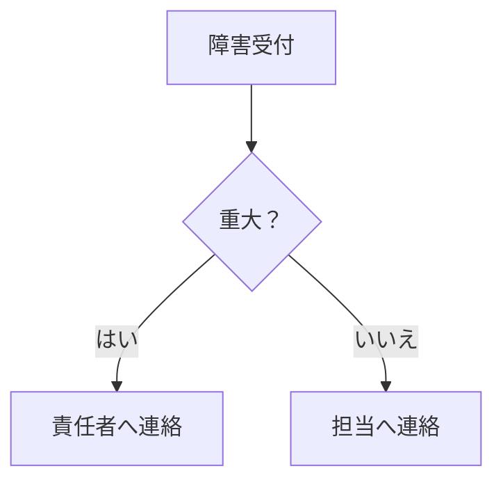

# 障害連絡フローの分岐を図にする｜Mermaid

障害が起きたとき、連絡先を手順書から探すと時間がかかります。重大度の分岐をMermaidで書き、連絡先までの道筋を見せます。

## 最初に知っておく用語

- **フローチャート**は、手順や分岐を矢印で示す図です。
- **ノード**は、図の中で作業や判断を表す箱です。

## フローチャートで考える

ひし形は判断を示します。「はい」と「いいえ」で連絡先が変わります。

## ライブデモ

[公開用ライブデモ](https://papanda925.github.io/Daily-Code-Samples/demos/mermaid-incident-flow/#live) ／ [実装HTML](../../docs/demos/mermaid-incident-flow/index.html) ／ [共通JavaScript](../../docs/demos/browser-library-labs/daily.js)

1. 現行のブラウザーでデモを開く。Mermaidの描画や一部のライブラリーに外部通信を使用する。
2. 「実行」を押す。下記の値や画面内の操作欄を試す。

図の「担当へ連絡」を別の文に変える。軽微の分岐も追加する。

### 結果の見方

入力を変えると連絡経路が描き直される。

連絡すべき人を箱に入れる。矢印には判断の結果を書く。重大度の判定基準や連絡先の詳細は本文に置く。

## コードの要点

flowchart TD で重大度のノードから二つの矢印を出し、ラベルを付ける。

実装はデモ画面の「実装コード」で確認できます。

## 仕事で使うとき

当番が図を見て連絡先を決められる粒度で書く。

## 参考資料

- [Mermaidの参照資料](https://github.com/mermaid-js/mermaid)
- [Mermaidの図の書き方](https://mermaid.js.org/intro/syntax-reference.html)

本文はAIを利用して作成しました。

## 実行環境と検証

JavaScriptの構文とファイル間の対応を確認した。 Pagesでの各機能の実行とMermaidの描画は検証範囲に含まれていない。

図が表示されない場合は、本文の読み方とMermaidソースを参照する。デモ欄に取得エラーが出る場合は通信条件を確認する。検証用の架空データを使う。
