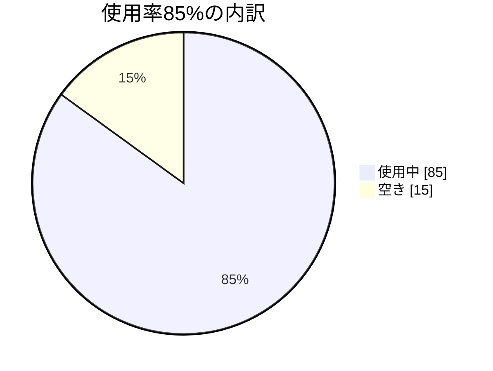

# 容量の警戒値をゲージで表す｜meter

ストレージの使用率は、パーセントだけでは緊急性が伝わりにくいことがあります。数値に状態名を添え、しきい値の直前と直後を比べます。

## 最初に知っておく用語

- **ゲージ**は、範囲の中の現在値を示す表示です。
- **しきい値**は、状態を切り替える基準値です。

## 円グラフで考える

全体を100%として内訳を示します。危険かどうかの判断には70%と90%のしきい値を使います。

## ライブデモ

[公開用ライブデモ](https://papanda925.github.io/Daily-Code-Samples/demos/meter-capacity-threshold/#live) ／ [実装HTML](../../docs/demos/meter-capacity-threshold/index.html) ／ [共通JavaScript](../../docs/demos/browser-library-labs/daily.js)

1. 現行のブラウザーでデモを開く。Mermaidの描画や一部のライブラリーに外部通信を使用する。
2. 「実行」を押す。下記の値や画面内の操作欄を試す。

69、70、89、90 を順に入れる。数値と状態を見比べる。

### 結果の見方

70から警戒。90から危険を表示する。

使用量の例なら低い値を望ましい範囲として扱う。温度など、中央の付近を望ましい範囲とする指標では設定を変える。

## コードの要点

max=100、low=70、high=90、optimum=0 を指定し、値の読み上げ用ラベルも付ける。

実装はデモ画面の「実装コード」で確認できます。

## 仕事で使うとき

色だけに頼らず、状態名と使用率も一緒に表示する。

## 参考資料

- [meterの参照資料](https://developer.mozilla.org/en-US/docs/Web/HTML/Element/meter)
- [Mermaidの図の書き方](https://mermaid.js.org/intro/syntax-reference.html)

本文はAIを利用して作成しました。

## 実行環境と検証

JavaScriptの構文とファイル間の対応を確認した。 Pagesでの各機能の実行とMermaidの描画は検証範囲に含まれていない。

図が表示されない場合は、本文の読み方とMermaidソースを参照する。デモ欄に取得エラーが出る場合は通信条件を確認する。検証用の架空データを使う。
