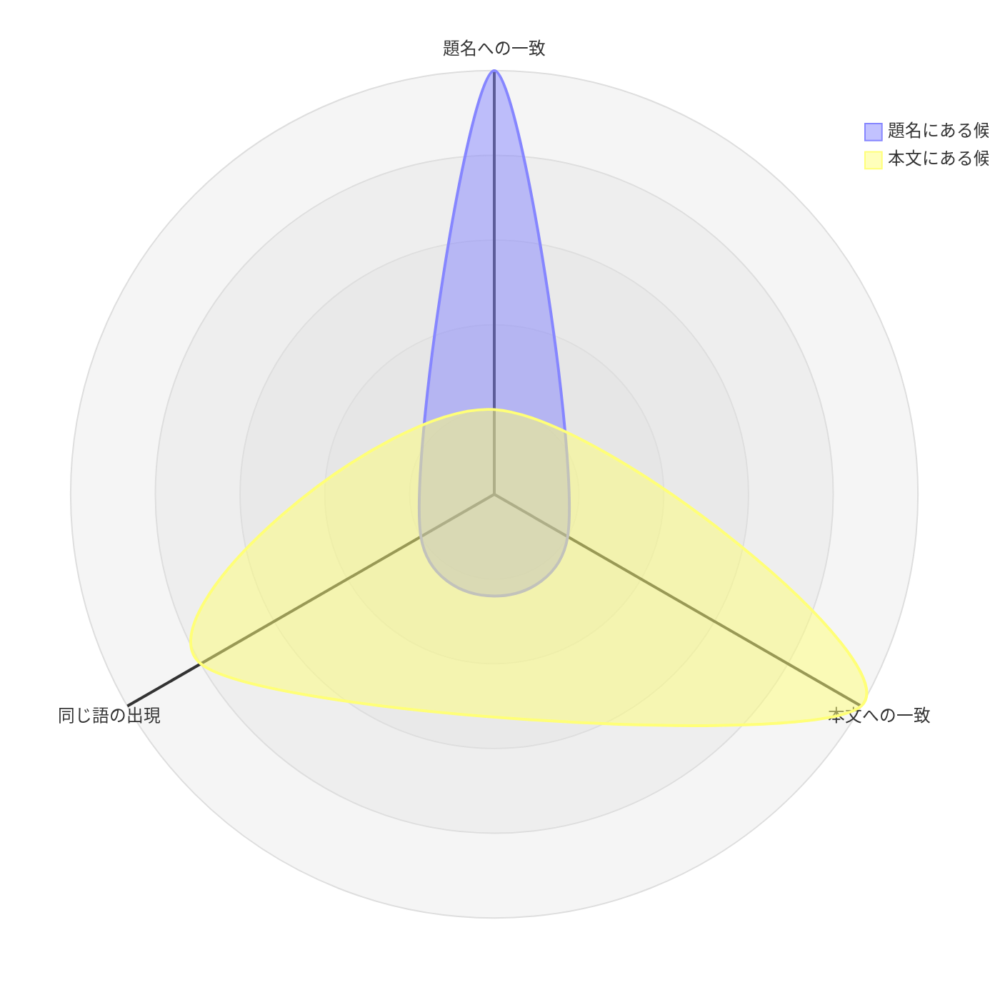

# FAQの検索順位をタイトル優先に調整する｜MiniSearch

「パスワードの再設定」を探した人に、本文で触れただけの記事が最初に出ることがあります。題名の重みを変え、同じ検索語で順位を比べます。

## 最初に知っておく用語

- **全文検索**は、文書の内容から語を探す処理です。
- **重み**は、検索順位に反映する重要度です。

## レーダー図で考える

軸ごとに候補の特徴を読みます。数字は観点を示す例です。検索ライブラリーの実測値はライブデモで読み取ります。

## ライブデモ

[公開用ライブデモ](https://papanda925.github.io/Daily-Code-Samples/demos/minisearch-faq-ranking/#live) ／ [実装HTML](../../docs/demos/minisearch-faq-ranking/index.html) ／ [共通JavaScript](../../docs/demos/browser-library-labs/daily.js)

1. 現行のブラウザーでデモを開く。Mermaidの描画や一部のライブラリーに外部通信を使用する。
2. 「実行」を押す。下記の値や画面内の操作欄を試す。

題名の重みを 1 と 5 で比べる。

### 結果の見方

重くすると題名に reset を含む文書が上がりやすい。

重みは検索全体を変える設定だ。一件目の順位だけで決めず、よく使う複数の検索語で並びを記録する。

## コードの要点

検索対象を title と body にして検索し、boost の title 値を変更する。

実装はデモ画面の「実装コード」で確認できます。

## 仕事で使うとき

毎回同じFAQに誘導したい場合は、重みを変更する前後で複数の検索語を試す。

## 参考資料

- [MiniSearchの参照資料](https://github.com/lucaong/minisearch)
- [Mermaidの図の書き方](https://mermaid.js.org/intro/syntax-reference.html)

本文はAIを利用して作成しました。

## 実行環境と検証

JavaScriptの構文とファイル間の対応を確認した。 Pagesでの各機能の実行とMermaidの描画は検証範囲に含まれていない。

図が表示されない場合は、本文の読み方とMermaidソースを参照する。デモ欄に取得エラーが出る場合は通信条件を確認する。検証用の架空データを使う。
