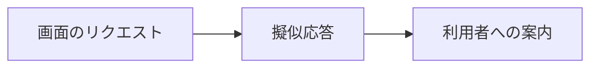

# API障害時の画面表示を本番に触らず確認する｜Mock Service Worker

APIが止まったときの案内は、原因で変える必要があります。正常、権限不足、一時停止の応答を作り、画面に出す文を確かめます。

## 最初に知っておく用語

- **モック**は、本物の代わりに決めた応答を返す処理です。
- **HTTPステータス**は、応答結果を表す番号です。

## 処理のフローチャートで考える

左から右に読みます。「擬似応答」が変わると「利用者への案内」にどう影響するかを予想します。



## ライブデモ

[公開用ライブデモ](https://papanda925.github.io/Daily-Code-Samples/demos/msw-status-response/#live) ／ [実装HTML](../../docs/demos/msw-status-response/index.html) ／ [共通JavaScript](../../docs/demos/browser-library-labs/daily.js)

1. 現行のブラウザーでデモを開く。Mermaidの描画や一部のライブラリーに外部通信を使用する。
2. 「実行」を押す。下記の値や画面内の操作欄を試す。

200、403、503 を順番に指定する。案内の違いを見る。

### 結果の見方

成功、権限の不足、一時的な停止を分けて表示する。

403 は権限の案内へ誘導する。503 は時間を置く案内を出す。同じ「エラー」でまとめると利用者は次の操作を選びにくい。

## コードの要点

対応する応答からブラウザー標準の Response を作り、案内の分岐を試します。MSW を使う場合は、案内を分ける処理はそのままに、擬似応答を返す部分をハンドラーに置き換えます。

実装はデモ画面の「実装コード」で確認できます。MSW で同じ応答を返すときは、`http.get` に検証用のURLを指定します。

```js
import { http, HttpResponse } from 'msw';

const handlers = [
  http.get('/demo-api/items', () =>
    HttpResponse.json({ message: '時間をおいて試してください。' }, { status: 503 })
  ),
];
```

ブラウザーで使う場合は、検証環境に MSW の Service Worker を配置します。詳しい準備は [README](../../docs/demos/browser-library-labs/README.md#記事40のmswを使う場合) を参照してください。

## 仕事で使うとき

実環境へ接続する前に、異常時の案内と再試行の導線を確認する。

## 参考資料

- [Mock Service Workerの参照資料](https://github.com/mswjs/msw)
- [Mermaidの図の書き方](https://mermaid.js.org/intro/syntax-reference.html)

本文はAIを利用して作成しました。

## 実行環境と検証

Node.jsで実行処理を確認した。 Pagesでの各機能の実行とMermaidの描画は検証範囲に含まれていない。

図が表示されない場合は、本文の読み方とMermaidソースを参照する。デモ欄に取得エラーが出る場合は通信条件を確認する。検証用の架空データを使う。
