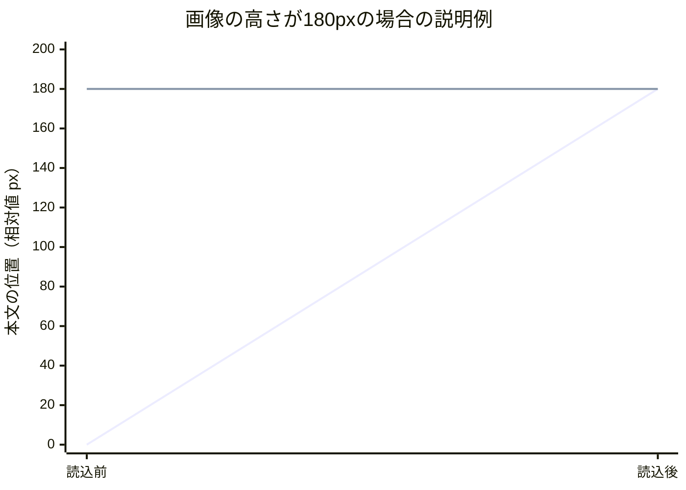

# 画像が読み込まれた瞬間のレイアウト移動を探す｜PerformanceObserver

画像が後から現れると、読んでいた本文が急に下へ動くことがあります。画像の領域を予約し、移動量を予約なしの場合と比べます。

## 最初に知っておく用語

- **レイアウトシフト**は、表示済みの要素が意図せず移動することです。
- **PerformanceObserver**は、ブラウザーの性能記録を受け取る仕組みです。

## XYチャートで考える

立ち上がる線は予約なしです。水平な線は予約ありです。この図は測定結果を予告する例で、実測値はライブデモで確かめます。

## ライブデモ

[公開用ライブデモ](https://papanda925.github.io/Daily-Code-Samples/demos/performance-layout-shift/#live) ／ [実装HTML](../../docs/demos/performance-layout-shift/index.html) ／ [共通JavaScript](../../docs/demos/browser-library-labs/daily.js)

1. 現行のブラウザーでデモを開く。Mermaidの描画や一部のライブラリーに外部通信を使用する。
2. 「実行」を押す。下記の値や画面内の操作欄を試す。

予約なし、予約ありの順に試す。本文の位置を見比べる。

### 結果の見方

予約ありでは画像が現れても本文の位置が変わりにくい。

計測値に加えて本文の移動ピクセル数も表示する。クリック直後の移動は、ページ全体の指標を集計する際に扱いが異なることがある。

## コードの要点

layout-shiftの対応を確認して記録し、移動値と発生時刻を比較する。

実装はデモ画面の「実装コード」で確認できます。

## 仕事で使うとき

画像に幅と高さを指定する。測定値が出ない環境では位置の差も確認する。

## 参考資料

- [PerformanceObserverの参照資料](https://developer.mozilla.org/en-US/docs/Web/API/PerformanceObserver)
- [Mermaidの図の書き方](https://mermaid.js.org/intro/syntax-reference.html)

本文はAIを利用して作成しました。

## 実行環境と検証

JavaScriptの構文とファイル間の対応を確認した。 Pagesでの各機能の実行とMermaidの描画は検証範囲に含まれていない。

図が表示されない場合は、本文の読み方とMermaidソースを参照する。デモ欄に取得エラーが出る場合は通信条件を確認する。検証用の架空データを使う。
