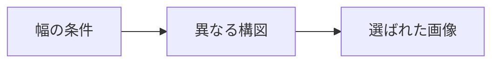

# 狭い画面では主役が見える画像を選ぶ｜picture

横長の画像を小さくするだけでは、主役が目立たなくなることがあります。狭い画面に別の構図を用意し、どちらが選ばれたかを見ます。

## 最初に知っておく用語

- **アートディレクション**は、表示環境に応じて画像の構図を変える工夫です。
- **代替テキスト**は、画像が見えない場合に伝える文です。

## 処理のフローチャートで考える

左から右に読みます。「異なる構図」が変わると「選ばれた画像」にどう影響するかを予想します。

## ライブデモ

[公開用ライブデモ](https://papanda925.github.io/Daily-Code-Samples/demos/picture-art-direction/#live) ／ [実装HTML](../../docs/demos/picture-art-direction/index.html) ／ [共通JavaScript](../../docs/demos/browser-library-labs/daily.js)

1. 現行のブラウザーでデモを開く。Mermaidの描画や一部のライブラリーに外部通信を使用する。
2. 「実行」を押す。下記の値や画面内の操作欄を試す。

ブラウザーの幅を600pxの前後で変える。現在の画像名を見る。

### 結果の見方

広い場合は全景。狭い場合は主役の拡大が選ばれる。

同じ画像を縮める方法と、構図を変える方法では主役の見え方が異なる。この例は構図の違いを見るために、二つの画像を用意する。

## コードの要点

source の media で幅を分け、img.currentSrc を表示する。

実装はデモ画面の「実装コード」で確認できます。

## 仕事で使うとき

画像を切り替えても、同じ目的が伝わる代替テキストを付ける。

## 参考資料

- [pictureの参照資料](https://developer.mozilla.org/en-US/docs/Web/HTML/Element/picture)
- [Mermaidの図の書き方](https://mermaid.js.org/intro/syntax-reference.html)

本文はAIを利用して作成しました。

## 実行環境と検証

JavaScriptの構文とファイル間の対応を確認した。 Pagesでの各機能の実行とMermaidの描画は検証範囲に含まれていない。

図が表示されない場合は、本文の読み方とMermaidソースを参照する。デモ欄に取得エラーが出る場合は通信条件を確認する。検証用の架空データを使う。
