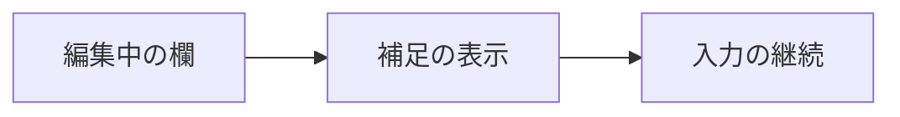

# 入力を続けながら補足ヘルプを表示する｜popover

申請理由を書くときに、入力例を少しだけ見たいことがあります。入力欄の脇に補足を出し、書きかけの内容を保てるか試します。

## 最初に知っておく用語

- **ポップオーバー**は、画面の上に出る小さな補足表示です。
- **ライトディスミス**は、外側を操作すると閉じる仕組みです。

## 処理のフローチャートで考える

左から右に読みます。「補足の表示」が変わると「入力の継続」にどう影響するかを予想します。

## ライブデモ

[公開用ライブデモ](https://papanda925.github.io/Daily-Code-Samples/demos/popover-input-hint/#live) ／ [実装HTML](../../docs/demos/popover-input-hint/index.html) ／ [共通JavaScript](../../docs/demos/browser-library-labs/daily.js)

1. 現行のブラウザーでデモを開く。Mermaidの描画や一部のライブラリーに外部通信を使用する。
2. 「実行」を押す。下記の値や画面内の操作欄を試す。

入力欄に文字を書く。入力例を開いて外側をクリックする。

### 結果の見方

補足が閉じても入力内容は残る。

入力例を開いたまま文字を入力できる。入力中に読ませたい短い補足なら、画面をロックする確認用の部品と使い分けやすい。

## コードの要点

popover を付けた要素を popovertarget ボタンで開き、外側をクリックする。

実装はデモ画面の「実装コード」で確認できます。

## 仕事で使うとき

短い入力例に向いている。必読事項は本文にも残す。

## 参考資料

- [popoverの参照資料](https://developer.mozilla.org/en-US/docs/Web/HTML/Global_attributes/popover)
- [Mermaidの図の書き方](https://mermaid.js.org/intro/syntax-reference.html)

本文はAIを利用して作成しました。

## 実行環境と検証

JavaScriptの構文とファイル間の対応を確認した。 Pagesでの各機能の実行とMermaidの描画は検証範囲に含まれていない。

図が表示されない場合は、本文の読み方とMermaidソースを参照する。デモ欄に取得エラーが出る場合は通信条件を確認する。検証用の架空データを使う。
