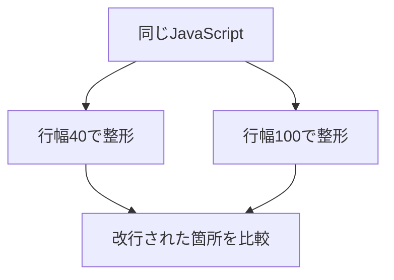

# 同じコードを異なる行幅で整形する｜Prettier

引数が増えると、同じJavaScriptが一行に収まりにくくなります。Prettierの二つの設定で、そのコードをどこで改行するか見比べます。

## 最初に知っておく用語

- **フォーマッター**は、ソースコードの見た目を整える道具です。
- **パーサー**は、コードを構造として読み取る処理です。

## 比較のフローチャートで考える

同じコードを二系統に分けます。結果の違いを、設定した行幅に結び付けて読めます。

## ライブデモ

[公開用ライブデモ](https://papanda925.github.io/Daily-Code-Samples/demos/prettier-line-width/#live) ／ [実装HTML](../../docs/demos/prettier-line-width/index.html) ／ [共通JavaScript](../../docs/demos/browser-library-labs/daily.js)

1. 現行のブラウザーでデモを開く。Mermaidの描画や一部のライブラリーに外部通信を使用する。
2. 「実行」を押す。下記の値や画面内の操作欄を試す。

コードをそのまま実行する。引数を一つ増やして差を確認する。

### 結果の見方

40 のほうが複数行に分かれやすい。

行幅は改行の判断に使う目安。長い文字列などは設定値を超えることがある。差が出なければ、引数を増やして試す。

## コードの要点

JavaScriptのパーサーを指定して format し、printWidth を40と100で切り替える。

実装はデモ画面の「実装コード」で確認できます。

## 仕事で使うとき

チームで整形設定を共有すると、レビューで変更内容を追いやすくなる。

## 参考資料

- [Prettierの参照資料](https://github.com/prettier/prettier)
- [Mermaidの図の書き方](https://mermaid.js.org/intro/syntax-reference.html)

本文はAIを利用して作成しました。

## 実行環境と検証

JavaScriptの構文とファイル間の対応を確認した。 Pagesでの各機能の実行とMermaidの描画は検証範囲に含まれていない。

図が表示されない場合は、本文の読み方とMermaidソースを参照する。デモ欄に取得エラーが出る場合は通信条件を確認する。検証用の架空データを使う。
