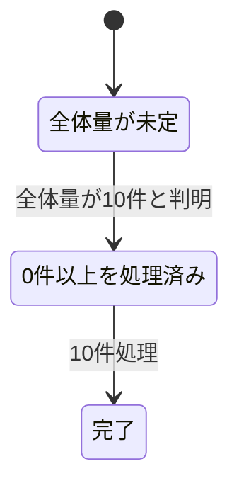

# 全体量が判明した時点で進捗を切り替える｜progress

集計を始めた時点では、全体で何件あるか分からないことがあります。総件数が判明する前と後で、進捗欄を切り替えます。

## 最初に知っておく用語

- **不定進捗**は、全体量が分からない進捗です。
- **確定進捗**は、処理済み量と全体量を示せる進捗です。

## 状態遷移図で考える

全体量が分かる瞬間に表示が切り替わります。その時点で処理件数が0でも確定進捗を表示できます。

## ライブデモ

[公開用ライブデモ](https://papanda925.github.io/Daily-Code-Samples/demos/progress-known-total/#live) ／ [実装HTML](../../docs/demos/progress-known-total/index.html) ／ [共通JavaScript](../../docs/demos/browser-library-labs/daily.js)

1. 現行のブラウザーでデモを開く。Mermaidの描画や一部のライブラリーに外部通信を使用する。
2. 「実行」を押す。下記の値や画面内の操作欄を試す。

未定と 0 と 6 を試す。表示と件数を比べる。

### 結果の見方

未定と 0/10 は異なる状態になる。

件数が判明した瞬間に進捗を初期化できる。処理済み件数が増えたら値だけを更新する。

## コードの要点

準備時はvalueを外し、件数が分かったら max=10 と現在値を設定する。

実装はデモ画面の「実装コード」で確認できます。

## 仕事で使うとき

全体量が判明するまでは割合を推測で表示しない。

## 参考資料

- [progressの参照資料](https://developer.mozilla.org/en-US/docs/Web/HTML/Element/progress)
- [Mermaidの図の書き方](https://mermaid.js.org/intro/syntax-reference.html)

本文はAIを利用して作成しました。

## 実行環境と検証

JavaScriptの構文とファイル間の対応を確認した。 Pagesでの各機能の実行とMermaidの描画は検証範囲に含まれていない。

図が表示されない場合は、本文の読み方とMermaidソースを参照する。デモ欄に取得エラーが出る場合は通信条件を確認する。検証用の架空データを使う。
