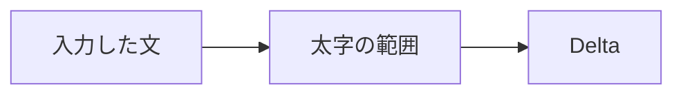

# リッチテキストの装飾をDeltaで観察する｜Quill

文章の一部を太字にすると、見た目のほかに内部のデータも変わります。書式を付けた範囲がどう記録されるかを観察します。

## 最初に知っておく用語

- **リッチテキスト**は、書式を含む文章です。
- **Delta**は、Quillが文章と書式を表す形式です。

## 処理のフローチャートで考える

左から右に読みます。「太字の範囲」が変わると「Delta」にどう影響するかを予想します。

## ライブデモ

[公開用ライブデモ](https://papanda925.github.io/Daily-Code-Samples/demos/quill-delta-format/#live) ／ [実装HTML](../../docs/demos/quill-delta-format/index.html) ／ [共通JavaScript](../../docs/demos/browser-library-labs/daily.js)

1. 現行のブラウザーでデモを開く。Mermaidの描画や一部のライブラリーに外部通信を使用する。
2. 「実行」を押す。下記の値や画面内の操作欄を試す。

文字を選んで太字にする。出力の attributes を探す。

### 結果の見方

太字の区間に属性が付く。最後の改行も記録される。

一部だけ太字にすると、書式付きと書式なしの区間が分かれる。文章の差分を扱うときは改行も一つの操作として読む。

## コードの要点

getContents() の値をJSON表示し、装飾前後を比べる。

実装はデモ画面の「実装コード」で確認できます。

## 仕事で使うとき

出力の形式を決めるときは、あとで編集を再開する要件も考える。

## 参考資料

- [Quillの参照資料](https://github.com/slab/quill)
- [Mermaidの図の書き方](https://mermaid.js.org/intro/syntax-reference.html)

本文はAIを利用して作成しました。

## 実行環境と検証

JavaScriptの構文とファイル間の対応を確認した。 Pagesでの各機能の実行とMermaidの描画は検証範囲に含まれていない。

図が表示されない場合は、本文の読み方とMermaidソースを参照する。デモ欄に取得エラーが出る場合は通信条件を確認する。検証用の架空データを使う。
