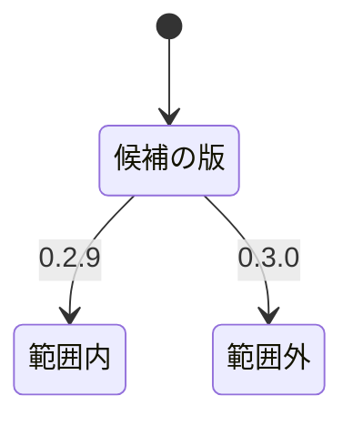

# npmの「^1.2.3」はどこまで更新できる？ 0.xとの違いをsemverで試す

npmの依存関係に ^ が付いていると、更新できる版には範囲があります。先頭が0の場合は範囲が狭くなります。

## 最初に知っておく用語

- **キャレット**は、互換性を想定して更新範囲を指定する記号です。
- **プレリリース**は、正式公開前の版です。

## 状態遷移図で考える

キャレットが ^0.2.3 の場合です。候補ごとに判定先をたどります。



## ライブデモ

[公開用ライブデモ](https://papanda925.github.io/Daily-Code-Samples/demos/semver-npm-caret/#live) ／ [実装HTML](../../docs/demos/semver-npm-caret/index.html) ／ [共通JavaScript](../../docs/demos/browser-library-labs/daily.js)

1. 現行のブラウザーでデモを開く。Mermaidの描画や一部のライブラリーに外部通信を使用する。
2. 「実行」を押す。下記の値や画面内の操作欄を試す。

^0.2.3 を入力する。0.2.9 と 0.3.0 を比べる。

### 結果の見方

0.2.9 は範囲内。0.3.0 は範囲外。

^1.2.3 と ~1.2.3 を比べると、1.3.0 の扱いが違う。^0.0.3 では 0.0.4 も範囲外になる。安定版が入る範囲でも、1.3.0-beta.1 は既定で外れる場合がある。

## コードの要点

semver.validRange で指定を検証します。semver.satisfies で候補ごとに範囲を判定します。

実装はデモ画面の「実装コード」で確認できます。

## 手元のNode.jsで詳しく試す

## まず試す

Node.jsとnpmを用意します。新しい作業フォルダーを作ります。ライブラリーはその中に入れます。

```sh
mkdir semver-lab
cd semver-lab
npm init -y
npm install --save-exact semver@7.8.5
```

次のコードを `demo.cjs` として保存する。

```js
const semver = require('semver');

const range = process.argv[2] ?? '^1.2.3';
const candidates = process.argv.slice(3);

if (!semver.validRange(range)) {
  console.error('範囲指定を確認してください:', range);
  process.exitCode = 2;
} else if (candidates.length === 0) {
  console.error('候補のバージョンを1つ以上指定してください。');
  process.exitCode = 2;
} else {
  console.table(candidates.map(version => ({
    version,
    result: !semver.valid(version)
      ? 'バージョン形式が不正'
      : semver.satisfies(version, range) ? '範囲内' : '範囲外',
  })));
}
```

```sh
node demo.cjs "^1.2.3" 1.2.2 1.2.3 1.9.0 2.0.0
node demo.cjs "^0.2.3" 0.2.2 0.2.3 0.2.9 0.3.0
node demo.cjs "^0.0.3" 0.0.2 0.0.3 0.0.4
```

| 範囲 | 起点より小さい | 起点 | 途中の候補 | 上限 |
|---|---|---|---|---|
| `^1.2.3` | 1.2.2は範囲外 | 1.2.3は範囲内 | 1.9.0は範囲内 | 2.0.0は範囲外 |
| `^0.2.3` | 0.2.2は範囲外 | 0.2.3は範囲内 | 0.2.9は範囲内 | 0.3.0は範囲外 |
| `^0.0.3` | 0.0.2は範囲外 | 0.0.3は範囲内 | — | 0.0.4は範囲外 |

## 先頭の0を見ると上限が分かる

この記事で使った3桁をすべて指定する書き方では、左から最初に0以外になる桁を見ればよい。`^1.2.3` では先頭の1、`^0.2.3` では中央の2、`^0.0.3` では末尾の3だ。その桁が次の値に達する安定版は範囲から外れる。起点より古い版も範囲外になる。

次は同じ候補のまま `^1.2.3` を `~1.2.3` に書き換えてみよう。1.2.9は両方に入り、1.3.0は `^` の場合だけ範囲に入る。マイナー版が上がる更新を含めたいかどうかで、同じ起点でも結果が変わる。

```sh
node demo.cjs "^1.2.3" 1.2.9 1.3.0
node demo.cjs "~1.2.3" 1.2.9 1.3.0
```

## プレリリースを候補に足す

`1.3.0-beta.1` を入力してみよう。既定の判定では `^1.2.3` に対して範囲外となる。数字の部分を見れば1.2.3から2.0.0までの間に見えるが、semverの既定の範囲判定では、プレリリースを許可する条件が別にある。安定版の表をそのままベータ版に当てはめると、結果を読み違える。

```sh
node demo.cjs "^1.2.3" 1.3.0-beta.1 1.3.0
```

## 範囲に入る版と、手元に入っている版を確かめる

この実験が答えるのは「候補の版が指定された範囲に入るか」だ。既存プロジェクトで調べるときは、`package.json` の指定を読んだうえで、`npm ls パッケージ名` で実際に入っている版を確かめる。再現用に記録された版を追うなら `package-lock.json` も見る。範囲判定で「範囲内」と出ても、その版に更新済みかどうかは実環境で確認する。

`Cannot find module 'semver'` が出た場合は、`demo.cjs` と `node_modules` を置いた実験用ディレクトリでコマンドを実行しているか確認する。範囲指定が不正と出た場合は、コピー時に引用符が全角へ変わっていないか、比較したい版が範囲指定の後ろに入っているかを確認する。

## 仕事で使うとき

更新作業では npm ls で実際の版を確かめる。範囲の指定だけでは、導入済みの版は分からない。

## 参考資料

- [node-semverのREADME（キャレットとプレリリース）](https://github.com/npm/node-semver#caret-ranges-123-025-004)
- [Mermaidの図の書き方](https://mermaid.js.org/intro/syntax-reference.html)

本文はAIを利用して作成しました。

## 実行環境と検証

Node.jsで実行処理を確認した。 Pagesでの各機能の実行とMermaidの描画は検証範囲に含まれていない。

図が表示されない場合は、本文の読み方とMermaidソースを参照する。デモ欄に取得エラーが出る場合は通信条件を確認する。検証用の架空データを使う。
