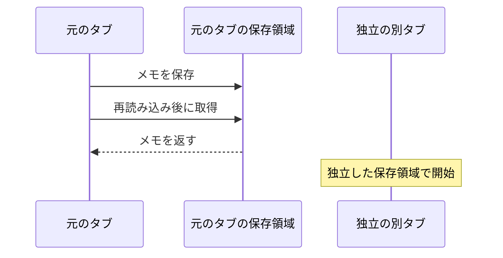

# 一時入力の保存範囲を再読み込みと別タブで確認する｜sessionStorage

作業中の入力を再読み込み後も残したい場合があります。タブを開き直す場合や別タブの場合と比べ、どこまで引き継がれるか確かめます。

## 最初に知っておく用語

- **セッション**は、この例ではタブに関連付く作業期間です。
- **オリジン**は、方式とホスト名とポートの組み合わせです。

## シーケンス図で考える

どのタブがどの保存領域にアクセスするかを示します。独立した別タブと再読み込みを比べます。

## ライブデモ

[公開用ライブデモ](https://papanda925.github.io/Daily-Code-Samples/demos/sessionstorage-tab-notes/#live) ／ [実装HTML](../../docs/demos/sessionstorage-tab-notes/index.html) ／ [共通JavaScript](../../docs/demos/browser-library-labs/daily.js)

1. 現行のブラウザーでデモを開く。Mermaidの描画や一部のライブラリーに外部通信を使用する。
2. 「実行」を押す。下記の値や画面内の操作欄を試す。

メモを保存して再読み込みする。アドレスを別のタブに直接入力する。

### 結果の見方

再読み込みでは残る。独立した別タブでは通常引き継がれない。

タブを複製した場合は初期値を引き継ぐことがある。比較用のタブは新しく開き、アドレスを直接入力する。

## コードの要点

sessionStorage に保存して再読込し、アドレスを直接入力した別タブでも同じ値があるか確認する。

実装はデモ画面の「実装コード」で確認できます。

## 仕事で使うとき

機密情報や長期保存が必要なデータの置き場にはしない。

## 参考資料

- [sessionStorageの参照資料](https://developer.mozilla.org/en-US/docs/Web/API/Window/sessionStorage)
- [Mermaidの図の書き方](https://mermaid.js.org/intro/syntax-reference.html)

本文はAIを利用して作成しました。

## 実行環境と検証

JavaScriptの構文とファイル間の対応を確認した。 Pagesでの各機能の実行とMermaidの描画は検証範囲に含まれていない。

図が表示されない場合は、本文の読み方とMermaidソースを参照する。デモ欄に取得エラーが出る場合は通信条件を確認する。検証用の架空データを使う。
