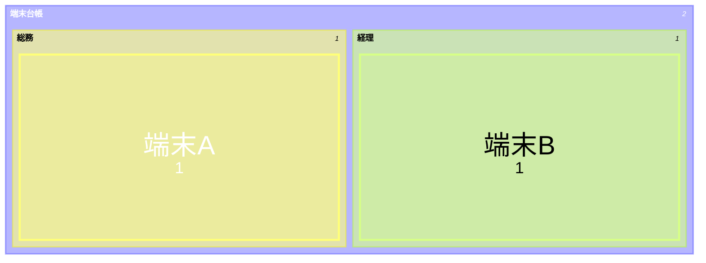

# 端末台帳の編集と絞り込みを一画面で行う｜Tabulator

端末台帳で部署を絞り込むと、編集する行を探しやすくなります。表示を絞ったまま値を編集し、全行表示に戻します。

## 最初に知っておく用語

- **フィルター**は、条件に合う行だけを表示する機能です。
- **永続化**は、画面を閉じてもデータを残すことです。

## ツリーマップで考える

外枠は全端末です。部署の内側に端末を置きます。面積の単位は端末1台です。

## ライブデモ

[公開用ライブデモ](https://papanda925.github.io/Daily-Code-Samples/demos/tabulator-inventory/#live) ／ [実装HTML](../../docs/demos/tabulator-inventory/index.html) ／ [共通JavaScript](../../docs/demos/browser-library-labs/daily.js)

1. 現行のブラウザーでデモを開く。Mermaidの描画や一部のライブラリーに外部通信を使用する。
2. 「実行」を押す。下記の値や画面内の操作欄を試す。

総務で絞る。名前のセルを編集する。条件を空欄にして実行する。

### 結果の見方

条件を解除しても変更した値が見える。

絞り込み中に値を変更すると、表示されている行のデータが変わる。ページを開き直す前に、保存先の有無を確認する。

## コードの要点

列に編集機能を指定し、部署フィルターを切り替える。

実装はデモ画面の「実装コード」で確認できます。

## 仕事で使うとき

同期や保存を追加するまで、編集中の値はこの画面内だけで扱う。

## 参考資料

- [Tabulatorの参照資料](https://github.com/olifolkerd/tabulator)
- [Mermaidの図の書き方](https://mermaid.js.org/intro/syntax-reference.html)

本文はAIを利用して作成しました。

## 実行環境と検証

JavaScriptの構文とファイル間の対応を確認した。 Pagesでの各機能の実行とMermaidの描画は検証範囲に含まれていない。

図が表示されない場合は、本文の読み方とMermaidソースを参照する。デモ欄に取得エラーが出る場合は通信条件を確認する。検証用の架空データを使う。
