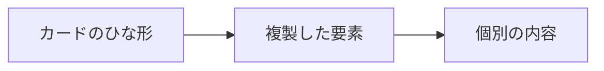

# カードのひな形を複製して別々の内容を入れる｜template

似たカードを追加するたびに画面の構造を書くと、項目が増えたときの修正が大変です。ひな形を複製し、一枚ずつ内容を入れます。

## 最初に知っておく用語

- **テンプレート**は、複製して再利用するひな形です。
- **クローン**は、構造をコピーした要素です。

## 処理のフローチャートで考える

左から右に読みます。「複製した要素」が変わると「個別の内容」にどう影響するかを予想します。

## ライブデモ

[公開用ライブデモ](https://papanda925.github.io/Daily-Code-Samples/demos/template-card-clone/#live) ／ [実装HTML](../../docs/demos/template-card-clone/index.html) ／ [共通JavaScript](../../docs/demos/browser-library-labs/daily.js)

1. 現行のブラウザーでデモを開く。Mermaidの描画や一部のライブラリーに外部通信を使用する。
2. 「実行」を押す。下記の値や画面内の操作欄を試す。

備品Aと備品Bをカンマで並べる。名前を増やして実行する。

### 結果の見方

それぞれのカードに別の名前が入る。

ひな形を追加しただけではカードは表示されない。複製した内容を画面へ挿入したときに初めて表示される。

## コードの要点

template.content を cloneNode(true) で複製し、各名前を textContent で設定する。

実装はデモ画面の「実装コード」で確認できます。

## 仕事で使うとき

複製する中身のIDは重ならないように設計する。

## 参考資料

- [templateの参照資料](https://developer.mozilla.org/en-US/docs/Web/HTML/Element/template)
- [Mermaidの図の書き方](https://mermaid.js.org/intro/syntax-reference.html)

本文はAIを利用して作成しました。

## 実行環境と検証

Node.jsで実行処理を確認した。 Pagesでの各機能の実行とMermaidの描画は検証範囲に含まれていない。

図が表示されない場合は、本文の読み方とMermaidソースを参照する。デモ欄に取得エラーが出る場合は通信条件を確認する。検証用の架空データを使う。
