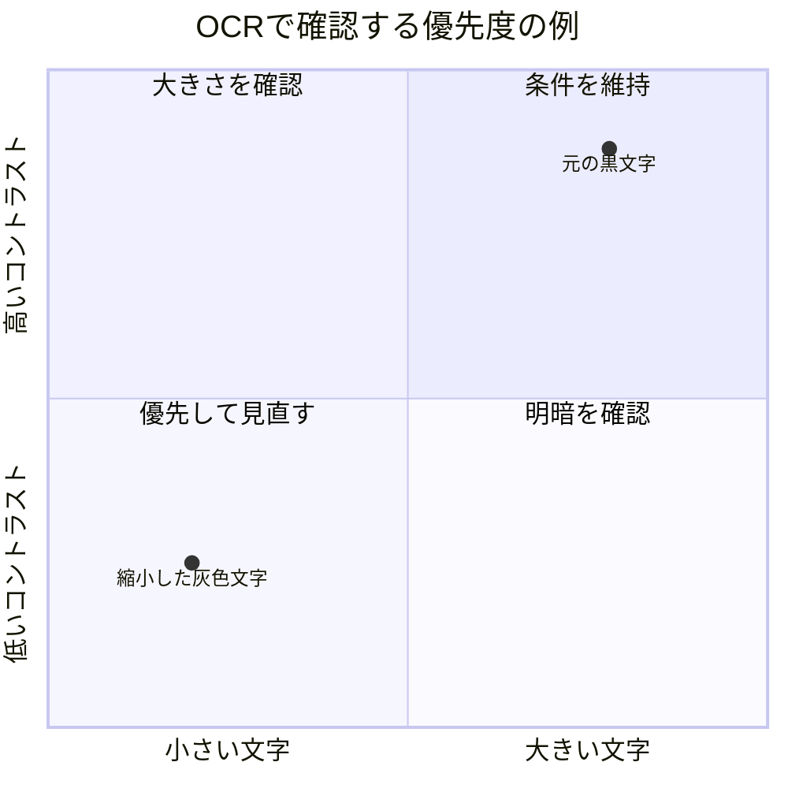

# ぼけた画像でOCRが読み違える箇所を探す｜Tesseract.js

帳票を小さい画像にすると、数字を読み違えることがあります。元の画像と縮小画像を同じOCRエンジンに渡して、どこから誤りが出るか見ます。

## 最初に知っておく用語

- **OCR**は、画像内の文字を読み取る処理です。
- **認識モデル**は、読み取りに使う学習済みデータです。

## 象限図で考える

二つの軸で見直す箇所を探します。点の座標は考え方を示す例です。

## ライブデモ

[公開用ライブデモ](https://papanda925.github.io/Daily-Code-Samples/demos/tesseract-image-quality/#live) ／ [実装HTML](../../docs/demos/tesseract-image-quality/index.html) ／ [共通JavaScript](../../docs/demos/browser-library-labs/daily.js)

1. 現行のブラウザーでデモを開く。Mermaidの描画や一部のライブラリーに外部通信を使用する。
2. 「実行」を押す。下記の値や画面内の操作欄を試す。

100 と 25 で実行する。表示された画像と認識結果を比較する。

### 結果の見方

縮小すると文字の輪郭が弱くなる。差が出なければ 12 も試す。

結果が空になっても画像の文字が消えたとは限らない。元画像の結果が正しく読める条件から、一項目ずつ下げる。

## コードの要点

英語モデルのワーカーで両方を recognize し、取得した文字列を原文と並べる。

実装はデモ画面の「実装コード」で確認できます。

## 仕事で使うとき

誤読の検証では向きと明るさを固定する。認識結果は原画像と照合する。

## 参考資料

- [Tesseract.jsの参照資料](https://github.com/naptha/tesseract.js)
- [Mermaidの図の書き方](https://mermaid.js.org/intro/syntax-reference.html)

本文はAIを利用して作成しました。

## 実行環境と検証

JavaScriptの構文とファイル間の対応を確認した。 Pagesでの各機能の実行とMermaidの描画は検証範囲に含まれていない。

図が表示されない場合は、本文の読み方とMermaidソースを参照する。デモ欄に取得エラーが出る場合は通信条件を確認する。検証用の架空データを使う。
