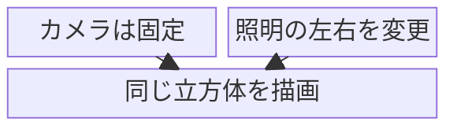

# 同じ3Dモデルの影の付き方を照明で変える｜three.js

同じ製品でも、光を当てる方向で形の見え方が変わります。立方体を固定して、光の位置だけを変えます。

## 最初に知っておく用語

- **平行光**は、一定方向から当たる光です。
- **材質**は、光を受けた面の見え方を決める設定です。

## ブロック図で考える

固定するものと動かすものを上段で分けます。比較する対象は同じ立方体です。

## ライブデモ

[公開用ライブデモ](https://papanda925.github.io/Daily-Code-Samples/demos/three-directional-light/#live) ／ [実装HTML](../../docs/demos/three-directional-light/index.html) ／ [共通JavaScript](../../docs/demos/browser-library-labs/daily.js)

1. 現行のブラウザーでデモを開く。Mermaidの描画や一部のライブラリーに外部通信を使用する。
2. 「実行」を押す。下記の値や画面内の操作欄を試す。

2 と -2 を試す。立方体の同じ面を見比べる。

### 結果の見方

左右どちらが明るいかが変わる。

色を比べる面を一つ決める。光の位置だけを変え、カメラの角度と材質をそろえる。

## コードの要点

MeshStandardMaterial と DirectionalLight を使い、カメラと物体の位置を固定して照明だけ移動する。

実装はデモ画面の「実装コード」で確認できます。

## 仕事で使うとき

製品の比較画像はカメラの位置と光量をそろえる。

## 参考資料

- [three.jsの参照資料](https://github.com/mrdoob/three.js)
- [Mermaidの図の書き方](https://mermaid.js.org/intro/syntax-reference.html)

本文はAIを利用して作成しました。

## 実行環境と検証

JavaScriptの構文とファイル間の対応を確認した。 Pagesでの各機能の実行とMermaidの描画は検証範囲に含まれていない。

図が表示されない場合は、本文の読み方とMermaidソースを参照する。デモ欄に取得エラーが出る場合は通信条件を確認する。検証用の架空データを使う。
