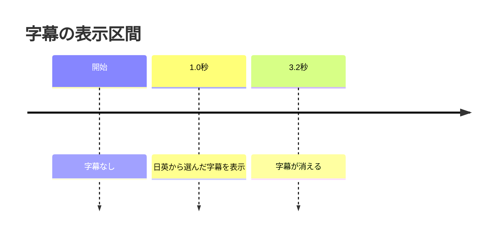

# 動画で日本語と英語の字幕を切り替える｜track

一つの動画には、複数の言語の字幕を付けられます。動画の同じ秒数を使って、字幕だけを切り替えます。

## 最初に知っておく用語

- **字幕トラック**は、時刻と字幕を組み合わせたデータです。
- **WebVTT**は、ブラウザーで使える時刻付き字幕形式です。

## タイムラインで考える

字幕の表示は動画の時刻に沿って進みます。1秒付近で言語の違いを確認できます。

## ライブデモ

[公開用ライブデモ](https://papanda925.github.io/Daily-Code-Samples/demos/track-language-switch/#live) ／ [実装HTML](../../docs/demos/track-language-switch/index.html) ／ [共通JavaScript](../../docs/demos/browser-library-labs/daily.js)

1. 現行のブラウザーでデモを開く。Mermaidの描画や一部のライブラリーに外部通信を使用する。
2. 「実行」を押す。下記の値や画面内の操作欄を試す。

日本語、英語、オフを順に選ぶ。2秒付近の表示を見比べる。

### 結果の見方

選んだ言語の字幕だけが表示される。

同じタイミングで言語だけを切り替えて比べる。選択メニューがない場合は、デモ内の字幕ボタンからも切り替えられる。

## コードの要点

track の kind、srclang、label を指定し、動画の字幕メニューから選ぶ。

実装はデモ画面の「実装コード」で確認できます。

## 仕事で使うとき

公開前に実動画と字幕の時刻を合わせる。

## 参考資料

- [trackの参照資料](https://developer.mozilla.org/en-US/docs/Web/HTML/Element/track)
- [Mermaidの図の書き方](https://mermaid.js.org/intro/syntax-reference.html)

本文はAIを利用して作成しました。

## 実行環境と検証

JavaScriptの構文とファイル間の対応を確認した。 Pagesでの各機能の実行とMermaidの描画は検証範囲に含まれていない。

図が表示されない場合は、本文の読み方とMermaidソースを参照する。デモ欄に取得エラーが出る場合は通信条件を確認する。検証用の架空データを使う。
