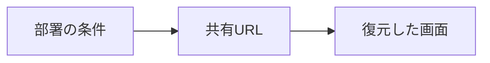

# 一覧の絞り込みをURLで共有する｜URLSearchParams

一覧の絞り込み条件をURLに含めると、同じ表示を別の人に渡せます。空白と記号を含む部署名で往復を試します。

## 最初に知っておく用語

- **クエリ文字列**は、URLの ? 以降に付く設定部分です。
- **エンコード**は、URLとして扱える文字の並びに変えることです。

## 処理のフローチャートで考える

左から右に読みます。「共有URL」が変わると「復元した画面」にどう影響するかを予想します。

## ライブデモ

[公開用ライブデモ](https://papanda925.github.io/Daily-Code-Samples/demos/urlsearchparams-filter/#live) ／ [実装HTML](../../docs/demos/urlsearchparams-filter/index.html) ／ [共通JavaScript](../../docs/demos/browser-library-labs/daily.js)

1. 現行のブラウザーでデモを開く。Mermaidの描画や一部のライブラリーに外部通信を使用する。
2. 「実行」を押す。下記の値や画面内の操作欄を試す。

総務 & 経理 と入力する。生成したリンクを開く。

### 結果の見方

記号込みの条件を入力欄へ復元できる。

アンパサンドを含む部署名で試す。文字列をそのままつなぐとパラメーターの境界と区別しづらい。URLSearchParams なら一つの値として取り出せる。

## コードの要点

searchParams.set で値を入れ、別タブの起動時に get で復元する。

実装はデモ画面の「実装コード」で確認できます。

## 仕事で使うとき

URLは転送される。機密度の高い検索語を入れない。

## 参考資料

- [URLSearchParamsの参照資料](https://developer.mozilla.org/en-US/docs/Web/API/URLSearchParams)
- [Mermaidの図の書き方](https://mermaid.js.org/intro/syntax-reference.html)

本文はAIを利用して作成しました。

## 実行環境と検証

Node.jsで実行処理を確認した。 Pagesでの各機能の実行とMermaidの描画は検証範囲に含まれていない。

図が表示されない場合は、本文の読み方とMermaidソースを参照する。デモ欄に取得エラーが出る場合は通信条件を確認する。検証用の架空データを使う。
