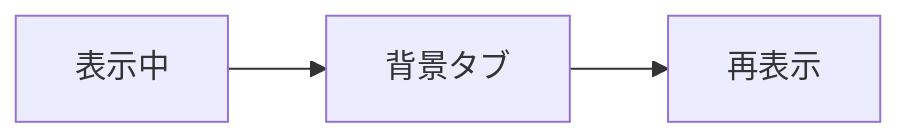

# 背景タブでカウンターを止める｜Page Visibility API

使っていないタブのタイマーを進め続けると、画面を見ていた時間と合わなくなります。タブが見えていた区間の秒数を足します。

## 最初に知っておく用語

- **可視状態**は、ページが画面に見えているかを表す状態です。
- **可視時間**は、見えていた時間の合計です。

## 処理のフローチャートで考える

左から右に読みます。「背景タブ」が変わると「再表示」にどう影響するかを予想します。

## ライブデモ

[公開用ライブデモ](https://papanda925.github.io/Daily-Code-Samples/demos/visibility-active-time/#live) ／ [実装HTML](../../docs/demos/visibility-active-time/index.html) ／ [共通JavaScript](../../docs/demos/browser-library-labs/daily.js)

1. 現行のブラウザーでデモを開く。Mermaidの描画や一部のライブラリーに外部通信を使用する。
2. 「実行」を押す。下記の値や画面内の操作欄を試す。

計測を開始し、別タブに移る。数秒待って戻る。

### 結果の見方

背景にいた時間は表示中の時間に含まれない。

別のタブへ移る直前の秒数を覚える。戻った直後に値を見て、待った秒数だけ大きく飛んでいないか調べる。

## コードの要点

visibilitychange が起きたら document.hidden を読みます。表示が終わった時点で経過時間を記録します。戻ったときは別の区間として計測します。

実装はデモ画面の「実装コード」で確認できます。

## 仕事で使うとき

経過時間を測る時計と、表示中だけ進める処理を区別する。

## 参考資料

- [Page Visibility APIの参照資料](https://developer.mozilla.org/en-US/docs/Web/API/Page_Visibility_API)
- [Mermaidの図の書き方](https://mermaid.js.org/intro/syntax-reference.html)

本文はAIを利用して作成しました。

## 実行環境と検証

JavaScriptの構文とファイル間の対応を確認した。 Pagesでの各機能の実行とMermaidの描画は検証範囲に含まれていない。

図が表示されない場合は、本文の読み方とMermaidソースを参照する。デモ欄に取得エラーが出る場合は通信条件を確認する。検証用の架空データを使う。
